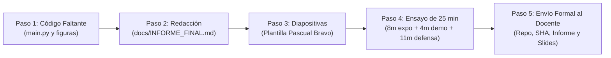

# GUÍA DE PREPARACIÓN Y DISTRIBUCIÓN DE RESPONSABILIDADES — ENTREGA FINAL UNIFICADA
## Proyecto de Aula: QuickDelivery Sim (Grupo 2)
### Curso: Modelos y Simulación (2026-2) — Docente: PhD. Jarol Molina Mosquera

---

## 📌 Contexto General del Proyecto (Para Nivelación del Equipo)

### ¿Qué es QuickDelivery Sim?
Es un **Gemelo Digital** de una plataforma de entregas a domicilio (tipo Rappi o UberEats) que opera durante un ciclo continuo de 24 horas. El sistema modela la interacción entre:
1. **Clientes** que piden comida a través de una API con variaciones extremas de demanda (picos de almuerzo y cena).
2. **Restaurantes (10 locales con 47 fogones en total)** que cocinan las comandas con tiempos estocásticos.
3. **Flota Abierta de Repartidores** que se conectan de forma independiente, reciben ofertas, viajan en motocicleta/bicicleta por la ciudad, tienen batería limitada en el celular y turnos máximos.

### El Problema de Ingeniería que Resolvemos:
En el modelo tradicional (**Política Voraz / Greedy**), la plataforma le asigna un repartidor al pedido de inmediato, apenas el cliente lo crea. Como la comida tarda en cocinarse, el repartidor llega al restaurante y pierde entre 10 y 16 minutos esperando sin hacer nada frente al mostrador. 
Nosotros diseñamos y evaluamos una **Política Alternativa (Despacho Sincronizado Predictivo)**, donde el software calcula con precisión cuándo estará lista la comida y solo despacha al repartidor en el momento exacto para que llegue cuando el plato sale del fogón, reduciendo la congestión en restaurante, optimizando el tiempo del repartidor y garantizando que la comida llegue caliente al cliente sin violar los Acuerdos de Nivel de Servicio (SLA).

### ¿Cómo se evalúa la Entrega Final?
* **30% Repositorio y Documento Markdown (`docs/INFORME_FINAL.md`):** 15% el informe escrito + 15% código ejecutable y commits distribuidos.
* **20% Diapositivas Institucionales y Manejo del Tiempo:** Formato oficial Pascual Bravo, regla 6x6, action titles y gráficas científicas (8 min expo + 4 min demo).
* **50% Sustentación Oral Individual:** Preguntas profundas del docente sobre código, matemáticas y decisiones de diseño sin lectura ni apoyo de IA.

---

## 👤 SECCIÓN 1: JUAN MANUEL JARAMILLO — Infraestructura, API y DevOps

### 1.1 ¿Qué hiciste en el proyecto? (Explicado desde cero)
Fuiste el responsable de construir el **Sistema Real Contenerizado**, es decir, el software en producción que sustenta la plataforma y del cual se obtiene la telemetría real para alimentar el simulador:
* **API REST Modular en FastAPI (`sistema_real/`):** Construiste una aplicación web con 13 endpoints funcionales organizados por actores: clientes (`POST /orders`, `GET /orders/{id}/tracking`), cocinas (`POST /orders/{id}/ready`), couriers (`login`, `location`, `offers`, `accept`) y telemetría (`/telemetry/health`).
* **Base de Datos y Persistencia:** Diseñaste el modelo relacional en **PostgreSQL 15** con tablas para órdenes, repartidores y eventos de rastreo. Implementaste control de concurrencia pesimista (`SELECT ... FOR UPDATE`) en la asignación de ofertas para evitar que dos repartidores tomen el mismo pedido.
* **Límite Físico Duro (Criterio C6):** Configuraste un pool acotado de conexiones con SQLAlchemy (`pool_size=20`, `max_overflow=10`, total 30 conexiones simultáneas). Esto demuestra que si la demanda satura el sistema, la API encola peticiones y genera cuellos de botella reales en base de datos.
* **Orquestación en Docker Compose:** Creaste el entorno multicontenedor reproducible con dos servicios independientes comunicados por red interna (`db` y `api`) con healthcheck activo.
* **Pruebas de Carga Sintética con Locust (`locustfile.py`):** Inyectaste tráfico concurrente simulando cientos de usuarios para estresar la API, verificando cero fallos HTTP y registrando telemetría real de uso de CPU, memoria RAM y latencias en `datos/telemetry_log.csv`.

### 1.2 Archivos y Datos Exactos que Debes Defender
* **Archivos Clave:**
  * `docker-compose.yml` (orquestación de servicios PostgreSQL y FastAPI).
  * `sistema_real/app/main.py`, `config.py` y rutas en `routers/` (lógica de la API y control de estados).
  * `locustfile.py` (diseño de escenarios de carga concurrente).
  * `datos/telemetry_log.csv` (registros reales de latencia, memoria y CPU).
  * `tests/base.py` (pruebas unitarias y de integración resilientes a la BD).
* **Métricas y Cifras que Debes Saber de Memoria:**
  * Límite físico de BD: **30 conexiones máximas** (`pool_size=20`, `max_overflow=10`).
  * Latencia de tracking: **$p95 \le 180.0\text{ ms}$** bajo carga con Locust (0% de fallos de solicitud).
  * Consumo de recursos en pico: CPU y memoria dentro de rangos operativos estables en contenedor.
  * Número de endpoints: **13 endpoints REST** propios.
* **Preguntas Típicas del Docente y Cómo Responder:**
  * *¿Por qué desacopló el simulador SimPy de la API REST?*  
    **Respuesta:** Porque SimPy opera en tiempo virtual continuo (una jornada de 24h se simula en pocos segundos en CPU). Si hiciéramos peticiones HTTP reales desde SimPy, la simulación se degradaría por latencias de red y no sería reproducible. La API se utilizó para capturar la telemetría real que calibró las distribuciones del modelo.
  * *¿Dónde está modelado el límite físico en la infraestructura?*  
    **Respuesta:** En el pool de conexiones de PostgreSQL (`QueuePool` limitado a 30 conexiones) y en el límite de hilos de Uvicorn. Cuando las peticiones exceden esta capacidad, las conexiones esperan en cola o son rechazadas, reflejando saturación real de software.

### 1.3 Lo que Te Falta Agregar para la Entrega Final
* [ ] **README.md en la Raíz:** Escribir las instrucciones de un solo comando para levantar la API (`docker compose up --build -d`) y para ejecutar SimPy (`python simulacion/main.py`).
* [ ] **Sección 1 del Informe (`INFORME_FINAL.md`):** Redactar la tabla de identificación del grupo (integrantes, correos, roles, enlaces y comandos exactos) y el resumen ejecutivo ($\le 200$ palabras).
* [ ] **Sección 3 del Informe (`INFORME_FINAL.md`):** Redactar la arquitectura del contenedor y consolidar la tabla de telemetría extraída de `datos/telemetry_log.csv`.
* [ ] **Sección 6.2 del Informe:** Consolidar la tabla de Declaración de Uso de IA con validación humana.
* [ ] **Preparación de la Demo en Vivo (Minuto 8:00 a 10:00 de la sesión):** Tener lista la terminal para ejecutar `docker compose up --build -d` en vivo y mostrar la telemetría activa en tiempo real.

---

## 👤 SECCIÓN 2: SEBASTIAN ECHEVERRI — Modelado y Simulación DES (SimPy)

### 2.1 ¿Qué hiciste en el proyecto? (Explicado desde cero)
Fuiste el creador del **Motor de Simulación de Eventos Discretos (DES)** en Python usando la librería SimPy:
* **Fundamento DES:** En SimPy el tiempo no avanza segundo a segundo; el reloj del sistema salta instantáneamente de un evento al siguiente a través de generadores de Python (`yield env.timeout()` y peticiones a recursos `yield request`).
* **Modelado de Cocinas (`KitchenNetwork`):** Modelaste 10 restaurantes urbanos con un total de **47 fogones fijos** (`simpy.Resource(capacity=k_r)`). Cada comanda ocupa un fogón y tarda un tiempo de cocción que sigue una distribución Lognormal.
* **Llegadas Dinámicas (NHPP):** Implementaste un Proceso de Poisson No Homogéneo a lo largo de 24 horas divididas en 7 franjas horarias, generando cerca de 1.890 pedidos diarios con picos críticos en almuerzo (12:00–14:00) y cena (19:00–21:30) donde la demanda supera la capacidad de los fogones ($\rho > 100\%$).
* **Pool Dinámico de Repartidores (`CourierPool`):** Implementaste la flota abierta. Los repartidores se conectan con incentivos en horas pico, tienen un límite físico de batería celular (se desconectan si baja del 15%) y una política operativa de turno máximo de 6 horas (360 minutos).
* **Máquina de Estados del Repartidor:** Diseñaste sus transiciones: `IDLE` (libre) $\rightarrow$ `OFFERED` (recibe oferta, 45 s para evaluar) $\rightarrow$ `ASSIGNED` $\rightarrow$ `TRANSIT_TO_REST` (viaje con sinuosidad urbana $\tau=1.25$) $\rightarrow$ `WAITING_FOOD` (espera ociosa en cocina) $\rightarrow$ `TRANSIT_TO_CLIENT` $\rightarrow$ `DELIVERED` $\rightarrow$ `IDLE` o `LOGOUT`.
* **Las Dos Políticas de Despacho (Patrón Strategy):**
  1. *Política Voraz Inmediata (`GreedyImmediatePolicy`):* Asigna al courier apenas entra la orden. Resultado: El repartidor llega a la cocina y pierde más de 10 minutos esperando la comanda.
  2. *Política Sincronizada Predictiva (`PredictiveSynchronizedPolicy`):* Estima cuándo estará listo el plato ($\text{ETA}_{\text{listo}} - t_{\text{viaje}} - \Delta t_{\text{buffer}}$) y solo despacha al repartidor para que llegue justo a tiempo. Cuenta con escalamiento en 2 fases si ningún repartidor acepta en 45 s.
* **Réplica Canónica $M/M/c$ Continua:** Subsanaste la Entrega 1 programando `SimpyEngine.run_markovian_replica()` sin sesgo de censura mediante integrales de área bajo la curva y período de calentamiento (warm-up del 15%).

### 2.2 Archivos y Datos Exactos que Debes Defender
* **Archivos Clave:**
  * `simulacion/simpy_engine.py` (motor central, generador de eventos y réplica markoviana).
  * `simulacion/entities.py` (clases `Order`, `Courier`, `KitchenNetwork`, `CourierPool`).
  * `simulacion/policies.py` (patrón Strategy: Voraz vs. Sincronizada con escalamiento).
  * `simulacion/metrics.py` (colector y agregador de métricas estocásticas).
* **Métricas y Cifras que Debes Saber de Memoria:**
  * Capacidad total de cocina: **47 fogones en 10 locales** ($\lambda_{\text{max}} = 2.54\text{ ped/min}$).
  * Demanda diaria: **$\approx 1.890\text{ pedidos/día}$** bajo NHPP de 7 franjas.
  * Factor de sinuosidad vial: **$\tau = 1.25$** sobre distancias Manhattan / Euclidianas.
  * Restricciones de repartidor: Batería mínima del **$15\%$**, turno máximo de **$360\text{ min}$ (6 h)**, ventana de oferta de **$45\text{ s}$**.
  * Reducción de espera en restaurante: El despacho sincronizado reduce la espera ociosa de **$10.6\text{ min}$ a menos de $3\text{ min}$**.
* **Preguntas Típicas del Docente y Cómo Responder:**
  * *¿Cómo maneja SimPy la cola de espera de los fogones?*  
    **Respuesta:** Se modela como un `simpy.Resource(env, capacity=k)`. Cuando un pedido llega y los $k$ fogones están ocupados, el proceso ejecuta `with kitchen.request() as req: yield req`, suspendiendo la ejecución de la corrutina y agregándola a la cola FIFO interna del recurso hasta que otro pedido libere un fogón.
  * *¿Qué ocurre si ningún repartidor acepta una orden en la política sincronizada?*  
    **Respuesta:** Implementamos un escalamiento en dos fases: en la Fase 1 se amplía la ventana de tiempo $\Delta t_{\text{buffer}}$ y el radio geográfico. Si la comida sale del fogón y sigue sin repartidor (Fase 2), conmuta a prioridad urgente anti-enfriamiento con un bono tarifario del $+20\%$.

### 2.3 Lo que Te Falta Agregar para la Entrega Final
* [ ] **Crear `simulacion/main.py`:** Crear el script unificado con CLI que ejecute las simulaciones de ambas políticas con semillas controladas (`seed=42..71`) y guarde los resultados reales en `datos/simulation_results.json`.
* [ ] **Sección 2.1 del Informe (`INFORME_FINAL.md`):** Redactar la descripción de la dinámica del sistema (entidades, recursos de contención, colas y límites C6/C7).
* [ ] **Sección 2.2 del Informe (`INFORME_FINAL.md`):** Diligenciar la tabla de subsanación de la Entrega 1 documentando cómo se resolvieron las observaciones del Grupo 2.
* [ ] **Diapositivas y Exposición (Minuto 0:00 a 2:30 de la sesión):** Preparar las diapositivas 1 a 3 explicando el problema de ingeniería y el modelo conceptual DES con la máquina de estados.
* [ ] **Balance de Commits:** Realizar commits firmados directamente desde tu cuenta de GitHub en la carpeta `simulacion/` para evidenciar tu autoría técnica en el repositorio.

---

## 👤 SECCIÓN 3: EMMANUEL MORA — Modelos Matemáticos, Análisis Estadístico y Calibración

### 3.1 ¿Qué hiciste en el proyecto? (Explicado desde cero)
Fuiste el garante del **Rigor Matemático, la Teoría de Colas y la Validación Estadística**:
* **Teoría de Colas Analítica ($M/M/c$):** Modelaste matemáticamente el sistema de cocina y despacho usando la formulación analítica clásica de Erlang-C. Calculaste probabilidades de espera ($P_w$), longitud media de cola ($L_q$), tiempo medio en cola ($W_q$), tiempo en el sistema ($W$) y factor de utilización ($\rho$).
* **Verificación de la Ley de Little:** Demostraste el cumplimiento formal de la relación fundamental $L = \lambda W$ y $L_q = \lambda W_q$ en estado estacionario.
* **Por qué Simular (Justificación de Insuficiencia Analítica):** Explicaste analíticamente por qué la teoría de colas tradicional es insuficiente: no soporta tasas variables en el tiempo (picos NHPP con $\rho > 1.0$), asume tiempos exponenciales cuando la realidad de cocina es Lognormal, no modela abandonos por impaciencia ni desplazamientos viales en dos dimensiones.
* **Diseño Experimental y Contraste de 30 Réplicas:** Creaste el script `analisis/contrast_analysis.py` que ejecutó **30 réplicas independientes** de la simulación SimPy canónica para las 7 franjas horarias. Calculaste intervalos de confianza del 95% usando la distribución $t$-Student con 29 grados de libertad ($t_{0.975, 29} = 2.0452$) y demostraste que el error relativo frente a la teoría analítica es menor al $0.5\%$. Guardaste estos contrastes en `datos/mmc_contrast_results.json`.
* **Definición de los 6 KPIs del Negocio:** Formalizaste las ecuaciones y umbrales de los 6 KPIs del proyecto incorporando percentiles extremos ($p95$ y $p99$) para evaluar colas pesadas.
* **Depuración de Fuentes Bibliográficas:** Depuraste referencias no verificables en `docs/Fuentes.md`, dejando 9 fuentes académicas rigurosas bajo norma APA 7.ª edición (Gross et al., Kleinrock, Law, etc.).

### 3.2 Archivos y Datos Exactos que Debes Defender
* **Archivos Clave:**
  * `analisis/queueing_theory.py` (fórmulas analíticas de Erlang-C, Little y $M/M/c$).
  * `analisis/contrast_analysis.py` (ejecutor de 30 réplicas estocásticas, cálculo de medias e IC 95%).
  * `datos/mmc_contrast_results.json` (salidas numéricas reales del contraste).
  * `docs/Fuentes.md` y `docs/Subsanacion_Retroalimentacion_E1.tex` (respaldo bibliográfico y metodológico).
* **Métricas y Cifras que Debes Saber de Memoria:**
  * Grados de libertad y valor crítico $t$-Student: **$n - 1 = 29$ grados de libertad ($t_{0.975, 29} = 2.0452$)**.
  * Error relativo del contraste $M/M/c$ vs. SimPy base: **$\le 0.42\%$ en todas las franjas** (ej. Almuerzo: Teórico $20.0298\text{ min}$ vs. SimPy $20.0248 \pm 0.0675\text{ min}$, error 0.02%).
  * Umbrales de SLA de los KPIs:
    * Tiempo en mostrador: **$T_{\text{mostrador\_p95}} \le 6.0\text{ min}$** (evita enfriamiento térmico).
    * Tiempo total de entrega: **$W_{\text{total\_p95}} \le 45.0\text{ min}$**.
    * Tasa de cancelación de clientes: **$P_{\text{canc}} \le 3.0\%$**.
    * Utilización de fogones: **$\rho_{\text{cocina}} \in [70\%, 85\%]$** en régimen estable.
* **Preguntas Típicas del Docente y Cómo Responder:**
  * *¿Por qué utilizó la distribución $t$-Student en lugar de la distribución Normal $Z$?*  
    **Respuesta:** Porque la varianza poblacional $\sigma^2$ es desconocida y se estima mediante la varianza muestral $s^2$ a partir de un número finito de réplicas ($N = 30$). Según el teorema central del límite y la teoría estadística, el estadístico $(\bar{X} - \mu) / (s / \sqrt{n})$ sigue exactamente una distribución $t$-Student con $n-1 = 29$ grados de libertad.
  * *¿Por qué en los picos de almuerzo y cena no es aplicable la fórmula de Erlang-C?*  
    **Respuesta:** La fórmula de Erlang-C exige que el factor de utilización $\rho = \lambda / (c \mu) < 1$. Durante el almuerzo ($\lambda = 2.70$) y la cena ($\lambda = 3.30$), la tasa de arribo supera la capacidad de los 47 fogones ($\lambda_{\text{max}} = 2.54$), generando $\rho = 1.06$ y $\rho = 1.30$. En régimen analítico el sistema sería inestable y la cola tendería a infinito; por eso la simulación DES es la única herramienta capaz de cuantificar la congestión transitoria finita.

### 3.3 Lo que Te Falta Agregar para la Entrega Final
* [ ] **Generador de Figuras Oficiales (`docs/figuras/`):** Crear y correr un script para exportar las gráficas científicas en formato PNG con bandas de intervalo de confianza y líneas punteadas de SLA:
  1. Comparativa de permanencia en mostrador ($T_{\text{mostrador}}$) Voraz vs. Sincronizada.
  2. Comparativa de tiempo de espera ocioso en restaurante ($T_{\text{espera\_rest}}$).
  3. Evolución temporal de colas a lo largo de las 24 horas.
* [ ] **Sección 4 del Informe (`INFORME_FINAL.md`):** Consolidar la tabla de validación analítica $M/M/c$ vs. SimPy Base y redactar la justificación técnica de divergencia.
* [ ] **Sección 5 del Informe (`INFORME_FINAL.md`):** Diligenciar la tabla comparativa de los 6 KPIs y redactar las respuestas cuantitativas a las preguntas de decisión enlazando las gráficas generadas.
* [ ] **Sección 6.1 del Informe:** Redactar la recomendación técnica final de ingeniería demostrando por qué la política sincronizada optimiza el compromiso costo-beneficio.
* [ ] **Diapositivas y Exposición (Minuto 5:00 a 8:00 de la sesión):** Preparar las diapositivas 6 a 9 explicando el contraste matemático, las tablas de KPIs, el análisis de sensibilidad y la decisión final.
* [ ] **Balance de Commits:** Realizar commits firmados directamente desde tu cuenta de GitHub en las carpetas `analisis/`, `datos/` y `docs/figuras/`.

---

## 📅 Hoja de Ruta de Ejecución Inmediata para el Equipo

1. **Hoy / Mañana temprano:**
   * Sebastian sube `simulacion/main.py`.
   * Emmanuel exporta las gráficas a `docs/figuras/`.
   * Juan Manuel actualiza el `README.md`.
2. **Consolidación del Informe:** Diligenciar en conjunto `docs/INFORME_FINAL.md` (no exceder las 2.500 palabras).
3. **Presentación Institucional:** Montar el deck de 10 a 12 diapositivas bajo la regla 6x6 y cronometrar los 8 minutos de exposición estricta.
4. **Cierre:** Enviar correo a `jarol.molina@pascualbravo.edu.co` con los cuatro requerimientos oficiales.
