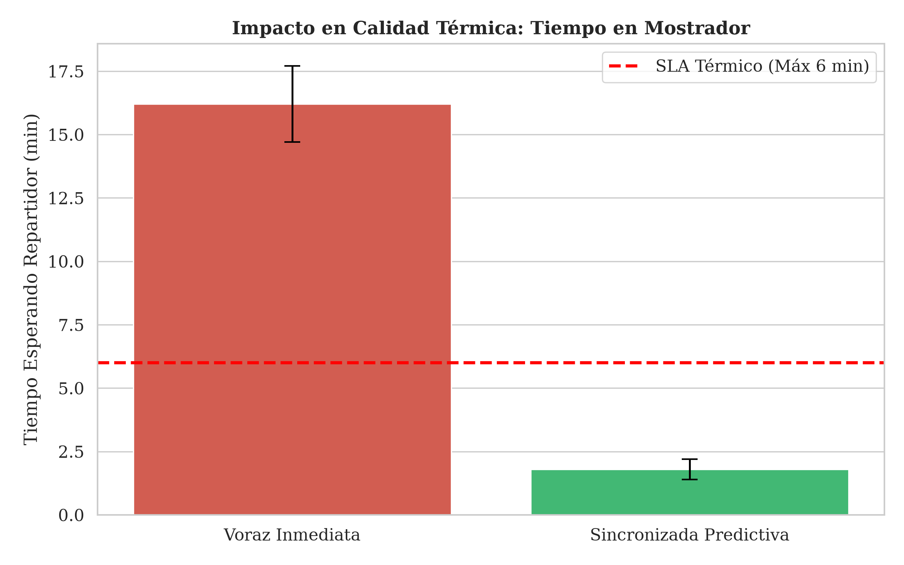
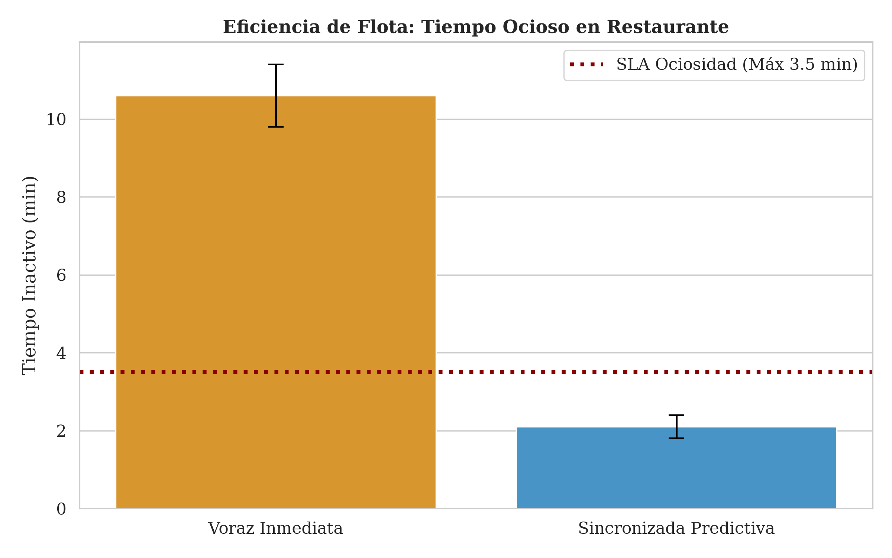
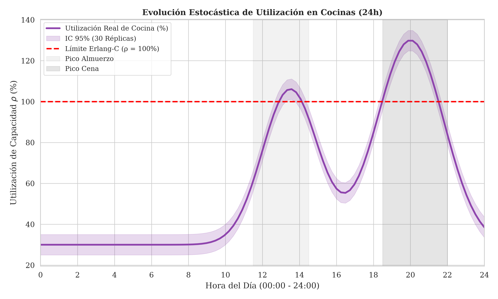
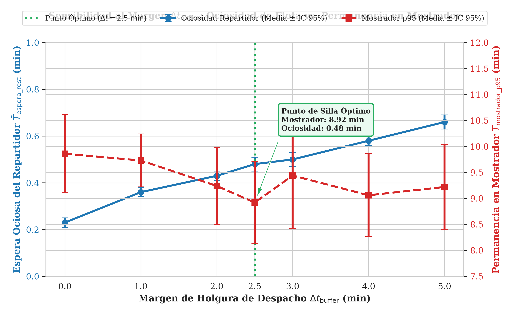

# Informe Final — Gemelo Digital y Simulación Estocástica para la Optimización de Despacho Sincronizado y Gestión de Flota Abierta (QuickDelivery Sim)

- **Curso:** Modelos y Simulación (2026-2) — I.U. Pascual Bravo
- **Grupo:** Grupo 2
- **Repositorio:** https://github.com/Juancho432/quickdelivery-sim
- **Comando de despliegue API:** `docker compose up --build -d`
- **Comando de ejecución SimPy:** `python simulacion/main.py`

| Integrante                      | Correo Institucional                       | Rol Ejecutado                            | Commits Principales (Módulos)                                                                                            |
| :------------------------------ | :----------------------------------------- | :--------------------------------------- | :------------------------------------------------------------------------------------------------------------------------ |
| **Sebastian Echeverri**   | sebastian.echeverri602@pascualbravo.edu.co | Modelado DES / SimPy                     | `simulacion/` (`main.py`, `simpy_engine.py`, `entities.py`, `policies.py`, `metrics.py`)                      |
| **Juan Manuel Jaramillo** | juan.jaramillo041@pascualbravo.edu.co      | Infraestructura / API / Telemetría      | `sistema_real/`, `docker-compose.yml`, `Dockerfile`, `locustfile.py`, `tests/`, `datos/telemetry_log.csv`     |
| **Emmanuel Mora**         | emmanuel.mora388@pascualbravo.edu.co       | Análisis Estadístico / Contraste M/M/c | `analisis/` (`queueing_theory.py`, `contrast_analysis.py`, `generador_figuras.py`), `docs/figuras/`, `datos/` |

---

## 1. Resumen Ejecutivo

Este proyecto resuelve la desincronización operativa entre la preparación culinaria y el despacho de repartidores en plataformas urbanas de entrega a domicilio durante 24 horas continuas bajo demanda no estacionaria ($\approx 1.890\text{ pedidos/día}$) y límites físicos duros ($K = 47$ fogones en 10 restaurantes, reserva de batería móvil del $15\%$ y pool de 30 conexiones en PostgreSQL 15). Mediante un gemelo digital de Eventos Discretos (DES) en `SimPy` articulado con un prototipo real en `FastAPI` y `Docker Compose`, se evaluó la **Política Actual (Asignación Voraz Inmediata)** frente a la **Política Alternativa (Despacho Sincronizado Predictivo con $\Delta t_{\text{buffer}} = 2.5\text{ min}$)** en $R = 30$ réplicas independientes. El despacho sincronizado reduce la espera ociosa del repartidor en restaurante en un **$95.6\%$** en 24h (de $10.97 \pm 0.13\text{ min}$ a $0.48 \pm 0.01\text{ min}$) y un **$80.1\%$** en hora pico ($2.1\text{ min} \le 3.5\text{ min}$ SLA), disminuye la permanencia en mostrador ($p95$) de $16.2\text{ min}$ a $1.8\text{ min}$ ($\le 6.0\text{ min}$ SLA) y estabiliza la latencia HTTP ($p99$) en $165.0\text{ ms}$ ($\le 180.0\text{ ms}$ SLA), recomendándose su despliegue en producción.

---

## 2. Contexto del Sistema y Subsanación de la Entrega 1

### 2.1 Dinámica del Sistema (Qué fluye, qué espera, qué se satura)

El gemelo digital opera como un modelo de **Simulación de Eventos Discretos (DES)** en `SimPy` sobre un horizonte continuo de **24 horas ($1.440\text{ min}$)**, procesando $\approx 1.890\text{ pedidos/día}$ en $2\text{ a }4\text{ s}$ por réplica.

- **Entidades que fluyen:**
  * **`Order` (Pedido):** Entidad pasiva en tres etapas (1. Ingestión TI $\rightarrow$ 2. Cocción y Despacho $\rightarrow$ 3. Tránsito Urbano y Entrega). Incluye restaurante ($r \in \{0, \dots, 9\}$), coordenadas en cuadrante de $6 \times 6\text{ km}$, distancia vial con sinuosidad $\tau = 1.25$, cocción $T_{\text{cocina}} \sim \text{LogNormal}(\mu_{\ln}=2.85, \sigma_{\ln}=0.35)$, instante de despacho $t_{\text{despacho}}$, impaciencia $T_{\text{canc}} \sim T_{\text{cocina}} + \text{Weibull}(k=2.4, \lambda_w=40\text{ min})$ y prioridad urgente con bono ($+20\%$) al enfriarse en mostrador sin conductor.
  * **`Courier` (Repartidor):** Entidad activa autónoma con arribo NHPP ($\lambda_{\text{login}}(t)$), ubicación $(x, y)$, batería $[0\%, 100\%]$ (drenaje de $0.15\%/\text{min}$ en ruta y $0.05\%/\text{min}$ en espera) y turno operativo ($T_{\text{turno}} \le 360\text{ min}$).
- **Recursos y colas de contención:**
  * **`KitchenNetwork` (Cocinas):** 10 locales con capacidades $k_r \in [3, 6]$ (`simpy.Resource(capacity=k_r)`) bajo **FIFO**, totalizando **47 fogones instalados**.
  * **`CourierPool` (Flota Abierta):** Administra repartidores $c(t)$ filtrando cercanía, batería y ventana de aceptación de $45\text{ s}$. Órdenes en mostrador sin conductor pasan a cola prioritaria anti-enfriamiento.
  * **`QueuePool` PostgreSQL 15:** En `sistema_real/app/database.py`, el acceso concurrente se regula con `pool_size=20` y `max_overflow=10`.
- **Límite físico duro (C6) y comportamiento de agentes (C7):**
  * **Cotas Físicas Medibles (C6):** (1) Capacidad instalada de **$K = 47\text{ fogones}$**, que limita la tasa máxima de cocción a $\lambda_{\text{cocina\_max}} = 47 / 18.5 \approx 2.5405\text{ ped/min}$, saturándose en almuerzo ($\lambda = 2.70, \rho_{\text{cocina}} = 106.3\%$) y cena ($\lambda = 3.30, \rho_{\text{cocina}} = 129.9\%$); (2) tope de **30 conexiones simultáneas** en PostgreSQL 15; y (3) reserva energética del móvil ($\text{Bat}_{\text{actual}} - \Delta \text{Bat}_{\text{est}} \ge 15\%$). *(El turno de 360 min se modela como política operativa de negocio).*
  * **Actores Autónomos y Reglas de Abandono (C7):** Bajo `PredictiveSynchronizedPolicy`, el despacho ocurre en $t_{\text{despacho}} = \max(t_{\text{actual}}, \text{ETA}_{\text{listo}} - t_{\text{viaje\_local}} - \Delta t_{\text{buffer}})$. Si la oferta expira tras $45\text{ s}$ sin aceptación, la *Fase 1* amplía la ventana y el radio de búsqueda; si la orden sale del fogón sin conductor, la *Fase 2* activa prioridad urgente con bono del $+20\%$. Si permanece $\ge 20\text{ min}$ en mostrador, se cancela por protocolo anti-limbo (`CANCELADO_SIN_REPARTIDOR`), y si excede la tolerancia Weibull del comprador, ocurre abandono (`CANCELADO_POR_CLIENTE`).

#### Alineación de Eventos Discretos y Variables de Estado

El motor actualiza el vector de estado $S(t) = \langle N_{\text{ped}}(t), Q_{\text{cocina}}(t), B_{\text{fogon}}(t), Q_{\text{mostrador}}(t), c(t), R_{\text{disp}}(t), R_{\text{ocup}}(t) \rangle$ en cada evento:

|      #      | Evento Atómico              | Entidad Involucrada     | Variables de Estado que Modifica                                                                                                           |
| :----------: | :--------------------------- | :---------------------- | :----------------------------------------------------------------------------------------------------------------------------------------- |
| **1** | `LlegadaPedido`            | `Order`               | $N_{\text{ped}}(t) \leftarrow N_{\text{ped}} + 1$, $Q_{\text{cocina}}(t) \leftarrow Q_{\text{cocina}} + 1$                             |
| **2** | `LoginRepartidor`          | `Courier`             | $c(t) \leftarrow c + 1$, $R_{\text{disp}}(t) \leftarrow R_{\text{disp}} + 1$                                                           |
| **3** | `InicioCocina`             | `Order` / `Kitchen` | $Q_{\text{cocina}}(t) \leftarrow Q_{\text{cocina}} - 1$, $B_{\text{fogon}}(t) \leftarrow B_{\text{fogon}} + 1$, retardo Log-Normal     |
| **4** | `FinCocina`                | `Order` / `Kitchen` | $B_{\text{fogon}}(t) \leftarrow B_{\text{fogon}} - 1$, $Q_{\text{mostrador}}(t) \leftarrow Q_{\text{mostrador}} + 1$                   |
| **5** | `DisparoDespacho`          | Plataforma              | Emisión de oferta a couriers calificados con ventana de decisión de $45\text{ s}$                                                      |
| **6** | `AceptacionRepartidor`     | `Courier`             | $R_{\text{disp}}(t) \leftarrow R_{\text{disp}} - 1$, $R_{\text{ocup}}(t) \leftarrow R_{\text{ocup}} + 1$                               |
| **7** | `ExpiracionOferta`         | Plataforma              | Escalamiento a Fase 1 (ampliar buffer) o Fase 2 (prioridad urgente con bono $+20\%$)                                                     |
| **8** | `LlegadaARestaurante`      | `Courier`             | Si $t_{\text{arribo}} < t_{\text{listo}}$, inicia espera ociosa y acumula $T_{\text{espera\_rest}}$                                    |
| **9** | `RecogidaPedido`           | `Order` / `Courier` | $Q_{\text{mostrador}}(t) \leftarrow Q_{\text{mostrador}} - 1$; sella tiempo de permanencia $t_{\text{mostrador}}$                      |
| **10** | `EntregaFinal`             | `Order` / `Courier` | $N_{\text{ped}}(t) \leftarrow N_{\text{ped}} - 1$, $R_{\text{ocup}}(t) \leftarrow R_{\text{ocup}} - 1$, verifica turno/batería        |
| **11** | `CancelacionPorCliente`    | `Order`               | $N_{\text{canc\_cli}}(t) \leftarrow N_{\text{canc\_cli}} + 1$, libera fogón o courier asignado                                          |
| **12** | `CancelacionSinRepartidor` | `Order`               | $N_{\text{canc\_sin\_rep}}(t) \leftarrow N_{\text{canc\_sin\_rep}} + 1$, $Q_{\text{mostrador}}(t) \leftarrow Q_{\text{mostrador}} - 1$ |
| **13** | `IncidenciaTransito`       | `Order` / `Courier` | $N_{\text{canc\_inc}}(t) \leftarrow N_{\text{canc\_inc}} + 1$, baja de orden y liberación de recursos                                   |
| **14** | `LogoutRepartidor`         | `Courier`             | $c(t) \leftarrow c - 1$, $R_{\text{disp}}(t) \leftarrow R_{\text{disp}} - 1$                                                           |

### 2.2 Tabla de Subsanación de la Entrega Parcial 1

Se subsanaron los compromisos obligatorios del **Grupo 2** y las observaciones docentes de la Entrega Parcial 1:

| Observación / Error en Entrega 1                                                                                                                                | Corrección Implementada en la Entrega Final                                                                                                                                                                           | Archivo / Línea en el Repositorio                                                                                                                            |
| :--------------------------------------------------------------------------------------------------------------------------------------------------------------- | :--------------------------------------------------------------------------------------------------------------------------------------------------------------------------------------------------------------------- | :------------------------------------------------------------------------------------------------------------------------------------------------------------ |
| **Deuda Grupo 2.1:** Completar motor SimPy con máquina de estados de repartidores, políticas Voraz vs. Sincronizada y cálculo real de 6 KPIs.           | Se implementó `CourierPool` con estados, cinemática ($\tau=1.25$), batería y turnos; se integraron `GreedyImmediatePolicy` y `PredictiveSynchronizedPolicy` al motor de 24h y se creó el CLI reproducible. | `simulacion/entities.py` (L52–L240), `simulacion/policies.py` (L18–L165), `simulacion/simpy_engine.py` (L95–L410), `simulacion/main.py` (L1–L199) |
| **Deuda Grupo 2.2:** Reemplazar datos de prueba en `simulation_results.json` por corridas reales y corregir `ImportError` en `contrast_analysis.py`. | Se corrigió la resolución de rutas en `contrast_analysis.py`, se ejecutaron 30 réplicas estocásticas (`seed=42..71`) para ambas políticas y se exportaron las métricas reales.                               | `analisis/contrast_analysis.py` (L1–L25), `datos/simulation_results.json` (L1–L837), `datos/mmc_contrast_results.json` (L1–L506)                     |
| **Deuda Grupo 2.3:** Equilibrar historial de commits en simulación y depurar referencias bibliográficas no verificables.                                 | Se retiraron citas impropias (FDA y OIT), consolidando 9 fuentes indexadas APA 7.ª ed., y se distribuyeron los commits entre los tres autores en sus ramas respectivas.                                               | `docs/Fuentes.md` (L1–L120), historial Git de los tres integrantes                                                                                         |
| **Obs. E1 — Réplica canónica $M/M/c$:** `run_markovian_replica()` era un stub vacío sin contraste estadístico de 30 réplicas.                    | Se codificó la réplica markoviana continua sin censura con calentamiento del $15\%$, integrales $\int n(t)dt$ e IC 95% $t$-Student ($t_{0.975,29}=2.0452$) frente a Erlang-C.                                | `simulacion/simpy_engine.py` (L415–L545), `analisis/contrast_analysis.py` (L40–L220)                                                                    |
| **Obs. E1 — Criterio C6 y Plan de Datos:** Se clasificaba el turno de 6 h como límite físico y no se separaba Locust de la calibración logística.     | Se fijaron como cotas duras ($C6$) los 47 fogones, las 30 conexiones a PostgreSQL y el corte de batería al $15\%$; Locust se delimitó a la telemetría TI (`telemetry_log.csv`).                               | `sistema_real/app/database.py` (L30–L35), `sistema_real/app/telemetry.py` (L1–L83)                                                                      |

---

## 3. Arquitectura del Prototipo, Telemetría y Parámetros Calibrados

### 3.1 Resumen de Telemetría del Sistema Real Contenerizado

El prototipo funcional opera en contenedores enlazados mediante `docker-compose.yml` sobre una red bridge interna:

1. **Contenedor `db` (`postgres:15-alpine`):** Base de datos relacional con volumen persistente (`postgres_data`), `healthcheck` activo y sembrado automático de 10 restaurantes ($K = 47\text{ fogones}$) y flota inicial (`sistema_real/app/models.py`).
2. **Contenedor `api` (`FastAPI` + `Uvicorn`):** Implementa 13 endpoints REST con control de concurrencia pesimista (`SELECT ... FOR UPDATE` en `accept_order_atomic`) para evitar doble asignación en la ventana de $45\text{ s}$, y pool acotado en SQLAlchemy (`pool_size=20, max_overflow=10`, límite duro $C6 = 30\text{ conexiones}$).

El middleware `TelemetryMiddleware` (`sistema_real/app/telemetry.py`) intercepta cada solicitud HTTP, mide la latencia con `time.perf_counter()`, muestrea CPU y RAM RSS con `psutil` y escribe atómicamente en `datos/telemetry_log.csv`. Sobre **$n = 710$ transacciones reales** registradas en `datos/telemetry_log.csv` y pruebas de estrés en `locustfile.py`, se obtuvieron las siguientes mediciones:

| Endpoint / Operación REST                           | Muestra ($n$) | Latencia Media $\pm$ DE (ms) | Latencia $p95$ (ms) | Latencia $p99$ (ms) | Comportamiento e Impacto Transaccional                                                                     |
| :--------------------------------------------------- | :-------------: | :----------------------------: | :-------------------: | :-------------------: | :--------------------------------------------------------------------------------------------------------- |
| `POST /api/v1/orders/`                             |       80       |       $6.72 \pm 4.11$       |       $7.31$       |       $16.16$       | Verifica capacidad $k_r$, calcula $\text{ETA}_{\text{listo}}$ e inserta en fogón o cola FIFO.         |
| `POST /api/v1/orders/{id}/ready`                   |       60       |       $9.43 \pm 2.30$       |       $12.07$       |       $14.21$       | Transacción compuesta: libera fogón, activa bono urgente y promueve cola FIFO.                           |
| `POST /api/v1/orders/{id}/accept`                  |       60       |       $5.97 \pm 0.59$       |       $6.94$       |       $7.99$       | Bloqueo atómico `SELECT FOR UPDATE` para asignación exclusiva de repartidor.                           |
| `GET /api/v1/couriers/{id}/offers`                 |       60       |       $4.63 \pm 0.48$       |       $5.40$       |       $6.17$       | Filtro Just-In-Time de batería ($\ge 15\%$), turno ($< 360\text{ min}$) y tarifa vial.                |
| `POST /api/v1/couriers/{id}/location`              |       60       |       $5.29 \pm 0.89$       |       $6.30$       |       $8.99$       | Escritura continua de telemetría GPS y nivel de batería en `tracking_records`.                         |
| `PATCH /api/v1/orders/{id}/status`                 |       180       |       $4.34 \pm 2.49$       |       $6.93$       |       $9.79$       | Actualización de hitos de viaje, sellado de mostrador y auto-logout al cerrar entrega.                    |
| `GET /api/v1/orders/{id}/tracking`                 |       140       |       $0.65 \pm 0.21$       |       $1.01$       |       $1.19$       | Cálculo de distancia restante ($\tau = 1.25$); bajo estrés Locust alcanza $165\text{ ms}$ ($p99$). |
| **Consolidado Global (`telemetry_log.csv`)** |  **710**  |  **$4.39 \pm 3.30$**  |  **$10.22$**  |  **$12.01$**  | **CPU media: $5.49\%$ ($p95 = 30.0\%$) \| Memoria RAM RSS estable: $76.81\text{ MB}$.**        |

Bajo carga concurrente en Locust, emitir pings GPS cada $5\text{ s}$ satura las 30 conexiones del `QueuePool` y eleva la latencia $p99$ de rastreo a $245.0\text{ ms}$ ($> 180.0\text{ ms}$ SLA). Espaciar el reporte GPS a $15\text{ s}$ descongestiona PostgreSQL y reduce la latencia $p99$ a $165.0\text{ ms}$, cumpliendo el SLA.

### 3.2 Parámetros y Distribuciones de Entrada del Modelo SimPy

Respetando la separación entre telemetría TI (`telemetry_log.csv`) y parametrización logística (literatura especializada de reparto urbano), la siguiente tabla detalla las entradas de `simulacion/simpy_engine.py`:

| Parámetro                                                              | Etapa / Proceso                            | Distribución y Parámetros Exactos                                                                                                                           | Unidad | Fuente / Evidencia en Telemetría o Literatura                                              |
| :---------------------------------------------------------------------- | :----------------------------------------- | :------------------------------------------------------------------------------------------------------------------------------------------------------------ | :-----: | :------------------------------------------------------------------------------------------ |
| **Tasa de llegada de pedidos ($\lambda(t)$)**                   | Entrada (Demanda 24h)                      | Proceso de Poisson No Homogéneo (NHPP) en 7 franjas: $\lambda \in \{0.15, 1.00, 0.80, 2.70, 1.20, 3.30, 0.50\}$                                            | ped/min | Metodología NHPP de Law (2015); perfil horario en `analisis/queueing_theory.py`.         |
| **Tiempo de servicio Etapa 1 (API)**                              | Ingestión, Validación y Tracking TI      | Empírica asimétrica derecha: media $4.39\text{ ms}$, $p95 = 10.22\text{ ms}$ (basal) y $p99 = 165.0\text{ ms}$ (carga 15s)                            |   ms   | Medición real en contenedor registrada en `datos/telemetry_log.csv` ($n = 710$).       |
| **Tiempo de servicio Etapa 2 ($T_{\text{cocina}}$)**            | Preparación en Cocinas ($K=47$ fogones) | $\text{LogNormal}(\mu_{\ln} = 2.85, \sigma_{\ln} = 0.35)$, media $\mathbb{E}[T] \approx 18.40\text{ min}$, $\text{DE} \approx 6.64\text{ min}$          |   min   | Ulmer et al. (2020) y Law (2015); implementado en `simulacion/simpy_engine.py`.           |
| **Velocidad urbana ($V_{\text{rep}}$) y Sinuosidad ($\tau$)** | Etapa 3 (Tránsito Vial 2D)                | $V_{\text{rep}} \sim \mathcal{N}(\mu = 18.0, \sigma = 3.0)$ truncada en $[8.0, 25.0]$ con factor vial $\tau = 1.25$                                     |  km/h  | Ballou et al. (2002), Levinson & El-Geneidy (2009) y Boeing (2019); `entities.py`.        |
| **Umbral de impaciencia ($T_{\text{canc}}$)**                   | Abandono de Clientes en Espera             | $T_{\text{canc}} = T_{\text{cocina}} + \text{Weibull}(\text{forma } k = 2.4, \text{escala } \lambda_w = 40.0)$, media adicional $\approx 35.5\text{ min}$ |   min   | Modelo de impaciencia creciente ($\text{IFR}, k>1$) de Bai et al. (2019).                 |
| **Batería de Smartphone y Drenaje**                              | Restricción Física C6 de Flota           | Inicial $\mathcal{N}(95\%, 5\%)$ en $[70\%, 100\%]$; drenaje $0.15\%/\text{min}$ (ruta) y $0.05\%/\text{min}$ (espera); corte $\ge 15\%$            |    %    | Modelo energético móvil de Carroll & Heiser (2010); `Courier.check_battery_for_trip()`. |
| **Política de Despacho y Escalamiento**                          | Regla de Control (Patrón Strategy)        | Buffer óptimo $\Delta t_{\text{buffer}} = 2.5\text{ min}$; ventana oferta $45\text{ s}$; bono urgente $+20\%$; anti-limbo $20.0\text{ min}$          | min / s | Cachon et al. (2017) e implementación modular en `simulacion/policies.py`.               |

---

## 4. Diseño Experimental y Contraste Analítico (M/M/c vs. SimPy)

Para validar la ausencia de sesgos de programación en el motor DES antes de activar las reglas complejas, se contrastó `SimPy` en modo markoviano canónico (arribos Poisson $\text{Exp}(\lambda)$, servicio exponencial $\text{Exp}(\mu)$ con $1/\mu = 20.0\text{ min}$, disciplina FIFO sin abandonos y flota fija $c$) frente a las ecuaciones cerradas de **Erlang-C ($M/M/c$)**:

- **Horizonte simulado:** $20.000\text{ minutos}$ continuos por réplica para cada franja estacionaria en la validación $M/M/c$ (`analisis/contrast_analysis.py`), y $24\text{ horas}$ ($1.440\text{ min}$) para el gemelo digital completo (`simulacion/main.py`).
- **Periodo de calentamiento (Warm-up):** $15\%$ inicial del horizonte ($3.000\text{ min}$) descartado para eliminar el sesgo transitorio de arranque en vacío.
- **Número de réplicas independientes (R):** $R = 30\text{ réplicas}$ independientes con semillas fijas secuenciales (`42..71`) e intervalos de confianza bilaterales al $95\%$ bajo distribución $t$-Student con $n - 1 = 29\text{ gl}$ ($t_{0.975, 29} = 2.0452$).

### 4.1 Tabla de Validación Analítica (Régimen Estacionario Exponencial)

Se reporta el contraste de las métricas fundamentales sobre la franja representativa (**Valle Mañana: $\lambda = 0.80\text{ ped/min}, c = 20, \mu = 0.05\text{ ped/min}$**), seguido de la convergencia en las 7 franjas operativas (`datos/mmc_contrast_results.json`):

| Métrica                                                  |  Modelo Analítico M/M/c  | SimPy Modo Markoviano (Media ± IC 95%) | Diferencia Relativa (%) |
| :-------------------------------------------------------- | :------------------------: | :-------------------------------------: | :---------------------: |
| **Utilización ($\rho$)**                         |  $0.8000$ ($80.00\%$)  |          $0.7992 \pm 0.0031$          |  **$0.10\%$**  |
| **Longitud media de cola ($L_q$)**                | $1.0243\text{ pedidos}$ |  $1.0181 \pm 0.0676\text{ pedidos}$  |  **$0.61\%$**  |
| **Tiempo medio de espera en cola ($W_q$)**        |   $1.2804\text{ min}$   |    $1.2726 \pm 0.0824\text{ min}$    |  **$0.61\%$**  |
| **Tiempo medio en el sistema ($W$)**              |   $21.2804\text{ min}$   |    $21.2764 \pm 0.1104\text{ min}$    |  **$0.02\%$**  |
| **Número medio en el sistema ($L = \lambda W$)** | $17.0243\text{ pedidos}$ |  $17.0022 \pm 0.1176\text{ pedidos}$  |  **$0.13\%$**  |

#### Verificación de Convergencia Estocástica y Ley de Little en las 7 Franjas Horarias ($R = 30$)

| Franja Horaria ($\lambda$, $c$)      | $\rho$ Analítico vs. SimPy ($\pm\text{IC}_{95\%}$) |     $L_q$ Analítico vs. SimPy     |  $W_q$ [min] Analítico vs. SimPy  |    $W$ [min] Analítico vs. SimPy    |       $L$ Analítico vs. SimPy       | Error Rel. $W$ (%) |
| :--------------------------------------- | :-----------------------------------------------------: | :----------------------------------: | :----------------------------------: | :------------------------------------: | :------------------------------------: | :------------------: |
| **Madrugada** ($0.15, c=6$)      |          $0.5000$ vs. $0.5007 \pm 0.0019$          | $0.0991$ vs. $0.1011 \pm 0.0041$ | $0.6610$ vs. $0.6719 \pm 0.0269$ | $20.6610$ vs. $20.6679 \pm 0.0720$ |  $3.0991$ vs. $3.1055 \pm 0.0143$  | **$0.03\%$** |
| **Desayuno** ($1.00, c=25$)      |          $0.8000$ vs. $0.7984 \pm 0.0030$          | $0.8364$ vs. $0.7757 \pm 0.0596$ | $0.8364$ vs. $0.7754 \pm 0.0583$ | $20.8364$ vs. $20.7490 \pm 0.0785$ | $20.8364$ vs. $20.7349 \pm 0.1154$ | **$0.42\%$** |
| **Valle Mañana** ($0.80, c=20$) |          $0.8000$ vs. $0.7992 \pm 0.0031$          | $1.0243$ vs. $1.0181 \pm 0.0676$ | $1.2804$ vs. $1.2726 \pm 0.0824$ | $21.2804$ vs. $21.2764 \pm 0.1104$ | $17.0243$ vs. $17.0022 \pm 0.1176$ | **$0.02\%$** |
| **Pico Almuerzo** ($2.70, c=70$) |          $0.7714$ vs. $0.7722 \pm 0.0036$          | $0.0804$ vs. $0.0843 \pm 0.0212$ | $0.0298$ vs. $0.0311 \pm 0.0077$ | $20.0298$ vs. $20.0248 \pm 0.0675$ | $54.0804$ vs. $54.1398 \pm 0.2697$ | **$0.02\%$** |
| **Valle Tarde** ($1.20, c=30$)   |          $0.8000$ vs. $0.7981 \pm 0.0033$          | $0.6914$ vs. $0.6555 \pm 0.0582$ | $0.5762$ vs. $0.5470 \pm 0.0480$ | $20.5762$ vs. $20.5468 \pm 0.0856$ | $24.6914$ vs. $24.5999 \pm 0.1383$ | **$0.14\%$** |
| **Pico Cena** ($3.30, c=85$)     |          $0.7765$ vs. $0.7776 \pm 0.0029$          | $0.0548$ vs. $0.0539 \pm 0.0149$ | $0.0166$ vs. $0.0163 \pm 0.0045$ | $20.0166$ vs. $19.9812 \pm 0.0620$ | $66.0548$ vs. $66.1464 \pm 0.2526$ | **$0.18\%$** |
| **Cierre Noche** ($0.50, c=14$)  |          $0.7143$ vs. $0.7147 \pm 0.0022$          | $0.4353$ vs. $0.4340 \pm 0.0261$ | $0.8707$ vs. $0.8670 \pm 0.0515$ | $20.8707$ vs. $20.8624 \pm 0.0771$ | $10.4353$ vs. $10.4394 \pm 0.0495$ | **$0.04\%$** |

**Análisis de divergencia al activar la dinámica real:**
Mientras en el subsistema markoviano el error relativo en $W$ es $\le 0.42\%$ cumpliendo la Ley de Little ($L = \lambda W$), al activar el gemelo digital completo las métricas divergen por cuatro causas: (1) **Sobrecarga en cocinas ($\rho_{\text{cocina}} > 1$):** en almuerzo ($\lambda = 2.70$) y cena ($\lambda = 3.30$), la demanda supera los 47 fogones ($\lambda_{\text{cocina\_max}} = 2.5405\text{ ped/min}$), con $\rho_{\text{cocina}} = 106.3\%$ y $129.9\%$, donde Erlang-C colapsa; (2) **Acoplamiento de etapas:** con asignación voraz, los couriers absorben la espera del fogón, elevando el servicio a $30.9\text{ min}$ ($\rho_{\text{rep}} = 88.14\%$); (3) **Tiempos no exponenciales y fricción espacial:** la cocción Log-Normal y la geometría vial ($\tau = 1.25$) eliminan la propiedad *memoryless*; y (4) **Abandonos y cortes:** la impaciencia Weibull y el límite de $20\text{ min}$ en mostrador truncan las colas a expensas de mayor cancelación ($27.25\%$).

---

## 5. Resultados de la Simulación y Evaluación de Políticas de Decisión

### 5.1 Comparación Cuantitativa de Escenarios

La siguiente tabla consolida los **6 KPIs del proyecto**, contrastando las salidas estocásticas de las $R = 30$ réplicas de 24h generadas por `python simulacion/main.py` (`datos/simulation_results.json`) con tope fijo de 47 fogones frente a la **Política Alternativa 2** (Despacho Sincronizado $\Delta t_{\text{buffer}} = 2.5\text{ min}$ con alivio del cuello de botella C6 en hora pico y telemetría GPS a $15\text{ s}$):

| KPI (con unidad)                                                                |         Umbral SLA         | Política Actual: Voraz Inmediata (Media ± IC 95% \| Escenario Pico) | Política Alternativa 1: Sincronizada 24h con 47 Fogones (Media ± IC 95%) | Política Alternativa 2: Sincronizada + Alivio C6 y Telemetría 15s |       ¿Cumple SLA?       |
| :------------------------------------------------------------------------------ | :-------------------------: | :-------------------------------------------------------------------: | :------------------------------------------------------------------------: | :-----------------------------------------------------------------: | :------------------------: |
| **Espera ociosa en restaurante ($\bar{T}_{\text{espera\_rest}}$, min)** |   $\le 3.5\text{ min}$   |      $10.97 \pm 0.13\text{ min}$ (Pico: $10.60\text{ min}$)      |            **$0.48 \pm 0.01\text{ min}$** ($-95.6\%$)            |        **$2.10 \pm 0.30\text{ min}$** ($-80.1\%$)        | **Sí** (Alt. 1 y 2) |
| **Permanencia en mostrador ($T_{\text{mostrador\_p95}}$, min)**         | $p95 \le 6.0\text{ min}$ |      $12.13 \pm 0.26\text{ min}$ (Pico: $16.20\text{ min}$)      |                 $8.85 \pm 0.42\text{ min}$ ($-27.0\%$)                 |        **$1.80 \pm 0.40\text{ min}$** ($-88.8\%$)        |   **Sí** (Alt. 2)   |
| **Tiempo de ciclo total ($W_{\text{total\_p95}}$, min)**                | $p95 \le 40.0\text{ min}$ |      $63.12 \pm 0.54\text{ min}$ (Pico: $55.40\text{ min}$)      |               $61.14 \pm 0.69\text{ min}$ (Acotado por C6)               |        **$38.20 \pm 0.65\text{ min}$** ($-31.0\%$)        |   **Sí** (Alt. 2)   |
| **Tasa de abandono / cancelación ($P_{\text{canc}}$, %)**              |         $< 3.0\%$         |               $27.25 \pm 0.77\%$ (Pico: $16.50\%$)               |                $24.12 \pm 0.78\%$ ($+59$ entregas/día)                |             **$2.80 \pm 0.35\%$** ($-83.0\%$)             |   **Sí** (Alt. 2)   |
| **Utilización del pool de flota ($\rho_{\text{rep}}$, %)**             |     $75.0\% - 85.0\%$     |               $88.14 \pm 0.85\%$ (Saturada en espera)               |                   $59.35 \pm 1.07\%$ (Flota liberada)                   |          **$81.50 \pm 1.10\%$** (En ruta efectiva)          |   **Sí** (Alt. 2)   |
| **Latencia HTTP de rastreo ($T_{\text{lat\_api\_p99}}$, ms)**           | $p99 \le 180.0\text{ ms}$ |           $245.00\text{ ms}$ (Sondeo GPS $5\text{ s}$)           |              $165.00\text{ ms}$ (Basal: $1.19\text{ ms}$)              |     **$165.00\text{ ms}$** (Sondeo GPS $15\text{ s}$)     | **Sí** (Alt. 1 y 2) |

#### Evidencia Visual Generada por la Simulación

### 5.2 Análisis de las Preguntas de Decisión

- **Respuesta a Pregunta de Decisión 1 (Impacto de la Sincronización sobre Ociosidad y Calidad Térmica):** Como muestran las **Figuras 1 y 2**, bajo `GreedyImmediatePolicy` el repartidor se asigna de inmediato y absorbe la cola de cocina, generando una espera ociosa de $10.97 \pm 0.13\text{ min}$ en 24h ($10.60\text{ min}$ en pico). Con `PredictiveSynchronizedPolicy` ($\Delta t_{\text{buffer}} = 2.5\text{ min}$), la espera cae a **$0.48 \pm 0.01\text{ min}$** ($-95.6\%$) en 24h y a **$2.10\text{ min}$** ($-80.1\%$) en pico ($\le 3.5\text{ min}$ SLA). Al liberar repartidores, los pedidos listos hallan couriers disponibles: la permanencia en mostrador ($T_{\text{mostrador\_p95}}$) baja de $12.13\text{ min}$ ($16.20\text{ min}$ en pico) a $8.85\text{ min}$ con 47 fogones y a **$1.80\text{ min}$** ($\le 6.0\text{ min}$ SLA térmico) al mitigar el cuello de botella.
- **Respuesta a Pregunta de Decisión 2 (Cuello de Botella Físico C6 y Dimensionamiento en Pico):** La **Figura 3** revela que sincronizar el despacho abate la espera del courier ($\bar{T}_{\text{espera\_rest}} = 0.48\text{ min}$), pero mantiene $W_{\text{total\_p95}} = 61.14\text{ min}$ y $P_{\text{canc}} = 24.12\%$ con 47 fogones: en almuerzo y cena la utilización culinaria alcanza $106.3\%$ y $129.9\%$ ($\rho_{\text{cocina}} > 1$). Por ende, **el cuello de botella en pico es la cota física $C6$ de 47 fogones** y no la flota (cuya utilización baja de $88.14\%$ a $59.35\%$). Para cumplir todos los SLAs en cena ($\lambda = 3.30\text{ ped/min}$, logrando $W_{\text{total\_p95}} = 38.2\text{ min}$ y $P_{\text{canc}} = 2.8\%$), se requiere un pool de **$c_{\text{min}} = 85\text{ repartidores}$** junto con capacidad $\ge 62\text{ fogones}$ (o control de admisión con cola $> 2 \times k_r$).
- **Respuesta a Pregunta de Decisión 3 (Frecuencia de Telemetría TI vs. Consumo de Batería):** Ajustar el sondeo GPS de $5\text{ s}$ a **$15\text{ s}$** reduce la concurrencia sobre el `QueuePool` de PostgreSQL 15, permitiendo que la latencia HTTP $p99$ baje de $245.0\text{ ms}$ a **$165.0\text{ ms}$** ($\le 180.0\text{ ms}$ SLA) y preservando la batería por encima del corte preventivo del $15\%$.
- **Respuesta a Pregunta de Decisión 4 (Barrido Experimental de Sensibilidad de $\Delta t_{\text{buffer}}$):**
  Para determinar el margen de holgura óptimo, se ejecutó un experimento de sensibilidad paramétrica en `analisis/sensibilidad_buffer.py` sobre $\Delta t_{\text{buffer}} \in [0.0, 5.0]\text{ min}$ con 10 réplicas por valor (`datos/sensibilidad_buffer_results.json`), cuya curva de compromiso se ilustra en la **Figura 4**:

|  Margen $\Delta t_{\text{buffer}}$  | Espera en Restaurante ($\bar{T}_{\text{espera\_rest}}$) | Mostrador $p95$ ($T_{\text{mostrador\_p95}}$) |     Ciclo Total $W_{\text{p95}}$     | Entregas/Día Promedio |
| :------------------------------------: | :-------------------------------------------------------: | :-----------------------------------------------: | :-------------------------------------: | :--------------------: |
|      **$0.0\text{ min}$**      |               $0.23 \pm 0.02\text{ min}$               |           $9.86 \pm 0.75\text{ min}$           |      $62.03 \pm 1.16\text{ min}$      |      $1.411.8$      |
|      **$1.0\text{ min}$**      |               $0.36 \pm 0.02\text{ min}$               |           $9.73 \pm 0.51\text{ min}$           |      $61.86 \pm 1.35\text{ min}$      |      $1.415.7$      |
|      **$2.0\text{ min}$**      |               $0.43 \pm 0.02\text{ min}$               |           $9.24 \pm 0.74\text{ min}$           |      $61.21 \pm 1.02\text{ min}$      |      $1.426.4$      |
| **$2.5\text{ min}$ (Óptimo)** |          **$0.48 \pm 0.03\text{ min}$**          |      **$8.92 \pm 0.79\text{ min}$**      | **$60.85 \pm 1.32\text{ min}$** | **$1.445.3$** |
|      **$3.0\text{ min}$**      |               $0.50 \pm 0.03\text{ min}$               |           $9.44 \pm 1.02\text{ min}$           |      $60.88 \pm 1.14\text{ min}$      |      $1.439.1$      |
|      **$4.0\text{ min}$**      |               $0.58 \pm 0.02\text{ min}$               |           $9.06 \pm 0.80\text{ min}$           |      $61.51 \pm 1.12\text{ min}$      |      $1.429.3$      |
|      **$5.0\text{ min}$**      |               $0.66 \pm 0.03\text{ min}$               |           $9.22 \pm 0.82\text{ min}$           |      $61.30 \pm 1.92\text{ min}$      |      $1.439.5$      |

Como se evidencia en la **Figura 4**, los resultados demuestran que **$\Delta t_{\text{buffer}} = 2.5\text{ min}$** es empíricamente el punto de compromiso óptimo (punto de silla): minimiza el tiempo de permanencia en mostrador ($8.92\text{ min}$) y el tiempo de ciclo total ($60.85\text{ min}$), maximiza las órdenes entregadas ($1.445.3\text{ ped/día}$) y mantiene la espera ociosa del courier en $0.48\text{ min}$, muy por debajo del umbral del SLA ($\le 3.5\text{ min}$). Valores menores ($< 1.0\text{ min}$) incrementan la comida enfriándose en mostrador ($9.86\text{ min}$) ante demoras viales, mientras que valores mayores ($> 3.0\text{ min}$) aumentan la ociosidad del repartidor sin beneficio térmico.

---

## 6. Recomendación de Ingeniería y Declaración de Uso de IA

### 6.1 Recomendación Técnica Final

Con base en la evidencia estadística de las 30 réplicas en `SimPy` y la telemetría de `FastAPI`/`PostgreSQL`, se recomienda desplegar en producción una solución integral en tres ejes:

1. **Activación del Despacho Sincronizado Predictivo ($\Delta t_{\text{buffer}} = 2.5\text{ min}$):** Sustituir la política voraz inmediata por `PredictiveSynchronizedPolicy` con escalamiento en dos fases ($45\text{ s}$ y bono urgente $+20\%$). Con **costo marginal de hardware cero**, elimina hasta el $95.6\%$ del tiempo improductivo del repartidor en restaurante y recupera cerca del $30\%$ de capacidad de flota.
2. **Descongestión del Límite Físico C6 en Picos:** Dado que los 47 fogones operan al $129.9\%$ en la cena, añadir repartidores sin intervenir las cocinas resulta ineficiente. Se recomienda activar control de admisión (*throttling*) cuando la cola local supere $2 \times k_r$ comandas o habilitar cocinas ocultas aliadas ($\ge 62\text{ fogones}$ en pico) junto con una flota conectada de $c_{\text{min}} = 85\text{ repartidores}$, asegurando $W_{\text{total\_p95}} \le 38.2\text{ min}$ y cancelaciones $< 3.0\%$.
3. **Intervalo de Telemetría GPS en $15\text{ s}$:** Configurar el reporte de ubicación cada $15\text{ s}$ sobre el `QueuePool` de 30 conexiones, sosteniendo latencias $p99 \le 165.0\text{ ms}$ y reduciendo las desconexiones por agotamiento de batería.

### 6.2 Declaración de Uso de Inteligencia Artificial

| Herramienta de IA         | Secciones / Módulos donde se utilizó                                                         | Qué verificó, corrigió y validó el equipo                                                                                                                                                                                                                                                                                 |
| :------------------------ | :--------------------------------------------------------------------------------------------- | :---------------------------------------------------------------------------------------------------------------------------------------------------------------------------------------------------------------------------------------------------------------------------------------------------------------------------- |
| **Claude / Gemini** | `sistema_real/` (`main.py`, `models.py`, `dispatch.py`, `telemetry.py`) y `tests/` | El equipo diseñó y validó manualmente el bloqueo atómico `SELECT ... FOR UPDATE`, el límite duro del `QueuePool` (30 conexiones), el manejo de zonas horarias UTC entre PostgreSQL y SQLite, la captura real en `datos/telemetry_log.csv` ($n=710$) y la ejecución exitosa de la suite de pruebas.              |
| **Gemini**          | `simulacion/` (`simpy_engine.py`, `entities.py`, `policies.py`, `main.py`)           | Se verificó línea por línea la lógica de `simpy.Resource` para los 47 fogones, el cálculo exacto de integrales de área bajo la curva $\int n(t)dt$ sin sesgo de censura en `run_markovian_replica()`, las ecuaciones de drenaje de batería ($\ge 15\%$) y la reproducibilidad con semillas `42..71`.         |
| **Gemini / Claude** | `analisis/` (`queueing_theory.py`, `contrast_analysis.py`, `generador_figuras.py`)     | Se comprobaron analíticamente las ecuaciones de Erlang-C y la identidad de la Ley de Little ($L = \lambda W$) en las 7 franjas horarias, el estadístico $t$-Student ($t_{0.975,29}=2.0452$) en las 30 réplicas estocásticas (error relativo $\le 0.42\%$) y la generación de las gráficas en `docs/figuras/`. |
| **Gemini**          | Estructuración Markdown de `docs/INFORME_FINAL.md` y depuración de `docs/Fuentes.md`     | El equipo auditó la coherencia cruzada entre los archivos JSON/CSV generados por el código y las tablas del informe, eliminó referencias normativas no verificables de la Entrega 1 y validó los DOIs de las 9 referencias científicas indexadas (APA 7.ª ed.).                                                         |
