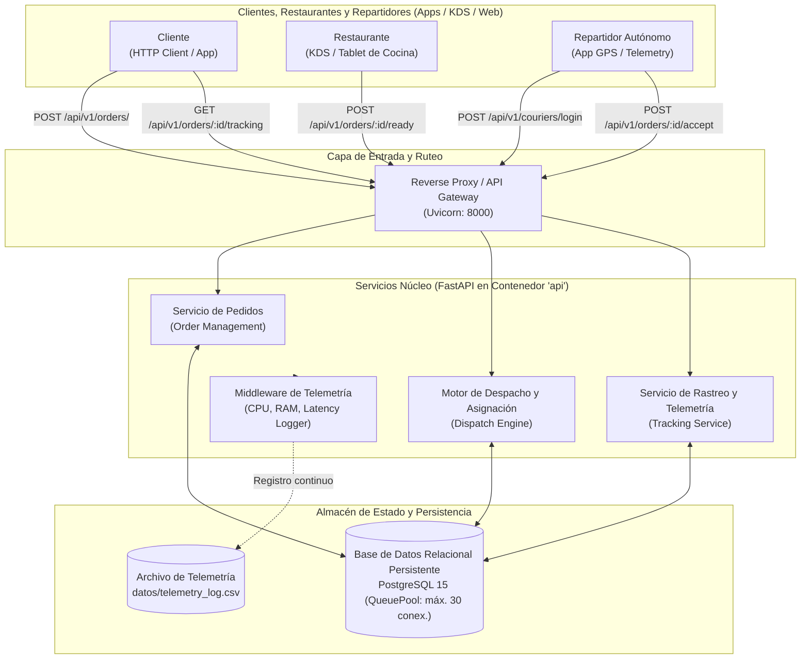
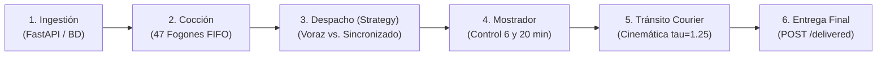
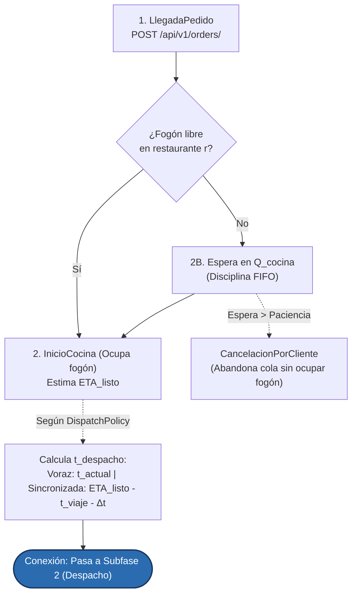
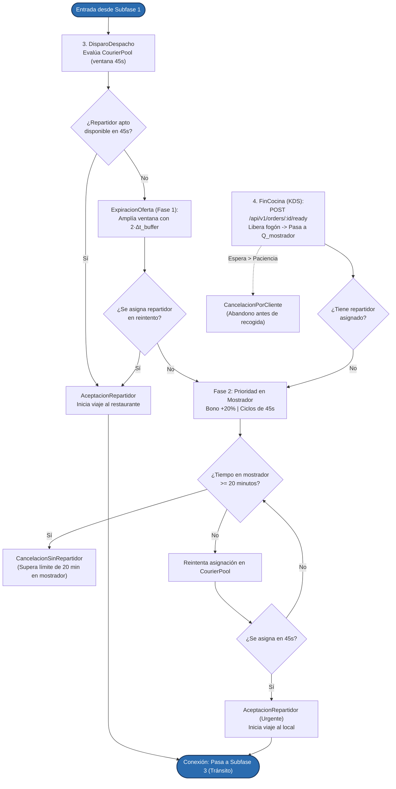
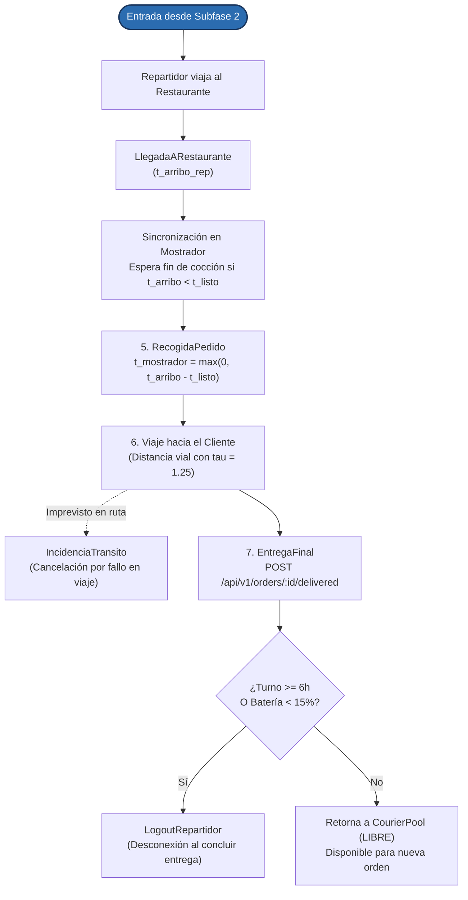
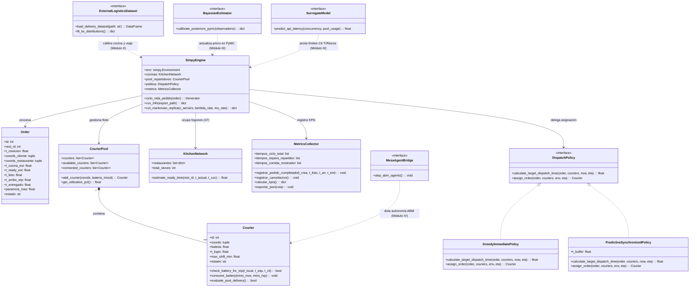

# PROYECTO DE AULA — ENTREGA PARCIAL 1

## Documento de Planteamiento: Gemelo Digital y Simulación Estocástica de una Plataforma de Pedidos a Domicilio (*QuickDelivery Sim*)

## 3.1 Identificación del Proyecto y Equipo de Trabajo

* **Nombre del Proyecto:** *Gemelo Digital y Simulación Estocástica para la Optimización de Despacho Sincronizado y Gestión de Flota Abierta en Plataformas de Pedidos a Domicilio (QuickDelivery Sim)*.
* **Integrantes del Grupo:**
  1. **Juan Manuel Jaramillo — Líder de Infraestructura y DevOps:**
     * *Rol:* Diseño e implementación de la API REST mínima en FastAPI, persistencia en PostgreSQL 15 con pool de conexiones acotado, orquestación en Docker Compose, instrumentación del middleware de telemetría de recursos (CPU, RAM, latencias HTTP) y diseño de pruebas de carga sintética con Locust.
  2. **Sebastian Echeverri — Líder de Modelado y Simulación Estocástica:**
     * *Rol:* Formalización del modelo conceptual DES (entidades, recursos, variables de estado y 14 eventos atómicos), implementación del motor ejecutable en SimPy (`simulacion/simpy_engine.py`) conectado al pool dinámico de repartidores (`CourierPool`), e implementación de las políticas de despacho voraz y sincronizada bajo el patrón Strategy.
  3. **Emmanuel Mora — Líder de Análisis de Datos, Modelos Matemáticos y Calibración:**
     * *Rol:* Formulación analítica de teoría de colas ($M/M/c$), deducción de las ecuaciones de Erlang-C y verificación de la Ley de Little, ejecución del contraste estadístico de 30 réplicas con intervalos de confianza del 95% frente a la Tabla 5 (`analisis/contrast_analysis.py`), definición de KPIs con percentiles ($p95/p99$), diseño de clases POO y plan de calibración con datos externos.
* **Enlace al Repositorio de Control de Versiones:**
  [https://github.com/Juancho432/quickdelivery-sim](https://github.com/Juancho432/quickdelivery-sim)

## 3.2 Descripción del Sistema Objeto de Estudio

### 3.2.1 Contexto de Negocio, Actores y Toma de Decisiones

El sistema objeto de estudio es una **plataforma de comercio electrónico y entrega de última milla** que opera en un entorno urbano continuo de **24 horas** (Ulmer et al., 2020). La plataforma actúa como un orquestador de software que coordina tres actores independientes:

1. **Los Clientes:** Usuarios que emiten pedidos a lo largo del día, consultan el avance del repartidor mediante el servicio de rastreo y presentan umbrales finitos de tolerancia a la espera, pudiendo cancelar su orden si la demora supera su paciencia máxima (Bai et al., 2019).
2. **Los Restaurantes Asociados:** Locales comerciales que reciben comandas validadas, disponen de una capacidad física finita de estaciones de cocción simultáneas (fogones) y operan con tiempos de preparación estocásticos (Ulmer et al., 2020).
3. **Los Repartidores Autónomos (*Flota Abierta*):** Conductores independientes que deciden cuándo conectarse (*login*) y desconectarse (*logout*) del sistema (Cachon et al., 2017). Durante su turno activo, reciben ofertas de viaje con una ventana operativa de 45 segundos para aceptar o rechazar, desplazándose hacia el restaurante para recoger el pedido y posteriormente hacia el domicilio del cliente.

**¿Quién toma la decisión de ingeniería?**
La decisión recae en el **Gerente de Operaciones Logísticas** y el **Líder de Ingeniería de Plataforma**. Su propósito es seleccionar y parametrizar la **política algorítmica del motor de despacho** y el **esquema de incentivos** para reducir el tiempo ocioso de los repartidores en los restaurantes, disminuir el percentil 95 del tiempo de ciclo de entrega y contener las cancelaciones durante las horas pico.

---

### 3.2.2 Comportamiento del Flujo y Cuellos de Botella (Qué fluye, qué espera y qué se satura)

* **Qué Fluye:** Fluyen **órdenes de pedido** (entidades que transitan desde solicitudes HTTP en la API, comandas en cocina, paquetes en mostrador, hasta entregas físicas en tránsito) y **mensajes de telemetría GPS** asociados al seguimiento de cada orden.
* **Qué Espera (Colas de Contención):**
  * *Cola de Cocina:* Los pedidos esperan la liberación de un fogón cuando la capacidad instalada $k_r$ del restaurante se encuentra ocupada en su totalidad.
  * *Cola de Despacho:* Los pedidos esperan en el motor de asignación hasta que un repartidor disponible en el pool sea asignado.
  * *Espera en Mostrador de Recogida:* Si el repartidor arriba al restaurante antes de que finalice la cocción, el repartidor espera inactivo en el local; inversamente, si la comida sale del fogón antes de que arribe el repartidor, el pedido espera en el mostrador perdiendo temperatura.
* **Qué se Satura:**
  * *En el plano físico-logístico (Almuerzo 11:30–14:30 y Cena 18:30–22:00):* Se satura la capacidad física de los fogones en los restaurantes ($\rho_{\text{cocina}} > 1$) y, bajo una asignación voraz inmediata, se agota el pool de repartidores libres debido al tiempo improductivo de espera en mostrador.
  * *En el plano de infraestructura TI:* Bajo ráfagas de consultas de rastreo y actualizaciones de estado, contiende el pool de conexiones concurrentes hacia la base de datos PostgreSQL y los workers del servidor HTTP.

---

### 3.2.3 Arquitectura del Sistema Real Mínimo

Como se muestra en la **Figura 1**, el sistema real mínimo desplegable se compone de servicios desacoplados y contenerizados mediante Docker Compose, con persistencia relacional e instrumentación de telemetría:

<strong>Figura 1.</strong> Arquitectura multicontenedor del sistema real e instrumentación de telemetría en Docker Compose.

* **Componentes Principales:**
  1. **API REST de Ingestión (`Order Management`):** Recibe las órdenes, verifica la disponibilidad de fogones del restaurante y registra las transiciones de estado.
  2. **Motor de Despacho (`Dispatch Engine`):** Evalúa las órdenes pendientes frente al pool de repartidores disponibles, aplicando la política configurada (Voraz Inmediata vs. Despacho Sincronizado).
  3. **Servicio de Rastreo (`Tracking Service`):** Almacena las actualizaciones de posición de los repartidores y responde las consultas de seguimiento de los clientes.
  4. **Base de Datos Relacional (`PostgreSQL 15`):** Persiste las entidades de restaurantes, órdenes, repartidores y trazas GPS a través de un pool de conexiones SQLAlchemy (`QueuePool` con `pool_size = 20` y `max_overflow = 10`).
  5. **Middleware de Telemetría:** Registra por cada petición HTTP la latencia de procesamiento en milisegundos y el uso de CPU y memoria RAM mediante `psutil`.

---

### 3.2.4 Clasificación Taxonómica del Modelo de Simulación

El modelo de simulación se ubica en las cuatro dimensiones de la taxonomía vista en clase (Law, 2015):

1. **Discreto vs. Continuo $\rightarrow$ DISCRETO:** Las variables de estado del sistema (pedidos en cola, fogones ocupados, repartidores libres) cambian únicamente en instantes puntuales del tiempo cuando ocurren eventos atómicos (`LlegadaPedido`, `FinCocina`, `AceptacionRepartidor`, `EntregaFinal`).
2. **Estático vs. Dinámico $\rightarrow$ DINÁMICO:** El modelo evoluciona a lo largo de un horizonte temporal continuo de 24 horas ($1.440\text{ minutos}$), donde el estado en un instante dado depende de la acumulación de colas en períodos previos.
3. **Determinista vs. Estocástico $\rightarrow$ ESTOCÁSTICO:** Los tiempos entre llegadas de órdenes, tiempos de cocción, velocidades de desplazamiento y umbrales de abandono se representan mediante variables aleatorias con distribuciones de probabilidad definidas.
4. **Empírico vs. Mecanístico $\rightarrow$ MECANÍSTICO:** El simulador modela explícitamente las relaciones causales de conservación de flujo, capacidad de servidores en serie y reglas de asignación entre órdenes, cocinas y repartidores.

---

### 3.2.5 Tabla de Cumplimiento de Criterios de Elegibilidad (C1 a C7)

La **Tabla 1** resume el cumplimiento de los siete criterios de elegibilidad del proyecto:

<strong>Tabla 1.</strong> Matriz de cumplimiento de criterios de elegibilidad del sistema (C1 a C7).

| Criterio | Exigencia del Curso | Cómo se Cumple y Evidencia en este Proyecto |
| :--- | :--- | :--- |
| **C1: Contención por recursos finitos** | Sistema TI o de software con colas y recursos limitados. | **Triple contención modelada:** Pool finito de conexiones a PostgreSQL (`QueuePool`, máx. 30) y workers de Uvicorn en la API; capacidad finita de cocción en 10 restaurantes ($k_r \in [3, 6]$ fogones, total 47); y pool finito de repartidores conectados ($c(t)$). |
| **C2: Sistema real mínimo desplegable** | API REST en contenedor con al menos 2 servicios y 3 endpoints propios. | **Arquitectura en Docker Compose (`api` + `db: postgres:15-alpine`)** con 13 endpoints transaccionales propios (`POST /api/v1/orders/`, `POST /api/v1/orders/{id}/ready`, `GET /api/v1/couriers/{id}/offers`, `POST /api/v1/orders/{id}/accept`, `GET /api/v1/orders/{id}/tracking`, entre otros). |
| **C3: $\ge 3$ etapas de servicio y regla de prioridad** | Red de colas con al menos 3 etapas y reglas de prioridad o tipología. | **3 Etapas de Servicio en Serie:** (1) Recepción y validación en API/BD, (2) Preparación en fogones de cocina, (3) Asignación de repartidor, recogida y entrega con rastreo. **Regla de Prioridad:** Prioridad para pedidos ya cocinados que esperan en mostrador (`LISTO_EN_MOSTRADOR`) con incentivo tarifario del +20% sobre órdenes aún en preparación. |
| **C4: Variable de decisión controlable** | Política o regla de control clara (política actual vs. alternativa). | **Política de Despacho (`DispatchPolicy`):** *Política Actual:* Asignación Voraz Inmediata (asigna repartidor al crearse la orden) vs. *Política Alternativa:* Despacho Sincronizado Predictivo ($t_{\text{despacho}} = \text{ETA}_{\text{listo}} - t_{\text{viaje}} - \Delta t_{\text{buffer}}$). |
| **C5: Llegadas no estacionarias** | Picos, estacionalidad o ráfagas que justifiquen análisis dinámico. | **Proceso de Poisson No Homogéneo (NHPP, $\approx 1.893\text{ ped/día}$ en 7 franjas):** Alternancia entre valles de baja utilización ($\rho_{\text{cocina}} = 6\%$) y picos de sobrecarga en cocinas durante el almuerzo ($\lambda = 2.70\text{ ped/min}$, $\rho_{\text{cocina}} = 106\%$) y la cena ($\lambda = 3.30\text{ ped/min}$, $\rho_{\text{cocina}} = 130\%$). |
| **C6: Límite físico o duro medible** | Cota física o dura medible que condiciona el comportamiento del sistema. | **Límites medibles en el sistema:** (1) *Capacidad física instalada de fogones:* $k_r \in [3, 6]$ por local ($K = 47$ fogones totales fijos en la red, que imponen una capacidad máxima sostenible $\lambda_{\text{cocina\_max}} = 47 / 18.5 \approx 2.54\text{ ped/min}$); (2) *Pool de conexiones a BD:* límite duro de $30$ conexiones simultáneas (`pool_size=20` + `max_overflow=10` en `database.py`) y tope de CPU ($100\%$); y (3) *Capacidad de batería del dispositivo móvil:* rango acotado $[0\%, 100\%]$ con reserva operativa mínima del $15\%$ (Carroll & Heiser, 2010). *(Nota: el tope de 6 h de sesión se modela como una política de la plataforma, no como límite físico).* |
| **C7: Actores autónomos para ABM (Mesa)** | Actores con comportamiento adaptativo y toma de decisiones. | **Repartidores:** Conectan y desconectan según incentivos y evalúan ofertas en ventanas de 45 s. **Clientes:** Monitorean el estado del pedido y cancelan cuando el tiempo de espera supera su umbral individual de paciencia (Bai et al., 2019). |

## 3.3 Problema y Preguntas de Decisión

### 3.3.1 Enunciado del Problema (1 Párrafo)

> En el escenario base de estudio de la plataforma de entregas urbanas, donde los repartidores operan bajo un esquema de flota abierta y la plataforma aplica una política operativa de desconexión tras 6 horas continuas de sesión o cuando la batería del dispositivo desciende al 15%, el sistema presenta saturación durante los picos de almuerzo (11:30–14:30) y cena (18:30–22:00). Como **hipótesis de escenario base**, bajo la política actual de asignación voraz inmediata —que despacha al repartidor en el instante en que el cliente crea la orden sin considerar la cola de los $47$ fogones instalados—, los repartidores permanecen en promedio $16.2\text{ minutos}$ inactivos en el restaurante esperando la salida del pedido, el percentil 95 del tiempo de ciclo total ($W_{\text{total\_p95}}$) supera los $55\text{ minutos}$, la tasa de cancelación alcanza el $16.5\%$ y las desconexiones anticipadas por consumo de batería e inactividad reducen hasta un $35\%$ la flota activa en horas pico. La gerencia de ingeniería requiere evaluar mediante simulación si sustituir la asignación voraz por una política de despacho sincronizado con el tiempo estimado de finalización en cocina ($\text{ETA}_{\text{listo}}$) permite reducir el tiempo ocioso del repartidor en el local, preservar la capacidad efectiva del pool de repartidores y disminuir las cancelaciones.

### 3.3.2 Preguntas de Decisión Cuantitativas (Política Actual vs. Alternativas)

1. **Pregunta de Decisión 1 (Sincronización y Productividad de Flota):** *¿En qué porcentaje se reduce el tiempo promedio de espera ociosa del repartidor en el restaurante ($\bar{T}_{\text{espera\_rest}}$, meta: $\le 3.5\text{ min}$) y cómo varía el número de pedidos completados al sustituir la política actual de asignación voraz inmediata por la política alternativa de despacho sincronizado predictivo ($t_{\text{despacho}} = \text{ETA}_{\text{listo}} - t_{\text{viaje}} - \Delta t_{\text{buffer}}$) durante una jornada de 24 horas?*
2. **Pregunta de Decisión 2 (Dimensionamiento de Flota en Hora Pico):** *¿Cuál es el tamaño mínimo del pool de repartidores activos conectados ($c_{\min}(t) \in [75, 95]$) que debe mantenerse en el pico de cena (18:30–22:00, $\lambda = 3.30\text{ ped/min}$) bajo despacho sincronizado frente a despacho voraz para sostener una utilización de flota ($\rho_{\text{rep}}$) entre el $75\%$ y el $85\%$, manteniendo $W_{\text{total\_p95}} \le 40\text{ min}$ y una tasa de cancelación inferior al $3\%$?*
3. **Pregunta de Decisión 3 (Frecuencia de Telemetría, Consumo de Batería y Pool de Conexiones TI):** *¿Qué efecto tiene modificar el intervalo de actualización de telemetría GPS del repartidor (sondeo cada $5\text{ s}$ frente a la alternativa de $15\text{ s}$) sobre el consumo acumulado de batería del dispositivo móvil y sobre el percentil 99 de latencia HTTP ($T_{\text{lat\_api\_p99}} \le 180\text{ ms}$) y la ocupación del pool de 30 conexiones de PostgreSQL bajo carga en Locust?*
4. **Pregunta de Decisión 4 (Margen de Holgura Cocina–Despacho):** *¿Cuál es el valor del margen de holgura temporal ($\Delta t_{\text{buffer}} \in [0, 5]\text{ minutos}$) en la regla de despacho sincronizado que minimiza conjuntamente el tiempo de espera del repartidor en el local ($\bar{T}_{\text{espera\_rest}}$) y el percentil 95 del tiempo de permanencia de la comida en mostrador ($T_{\text{mostrador\_p95}} \le 6.0\text{ min}$)?*

## 3.4 Objetivos del Proyecto

### 3.4.1 Objetivo General

Desarrollar un gemelo digital estocástico basado en simulación de eventos discretos (DES) y modelado multiagente (ABM) para una plataforma de pedidos a domicilio en un horizonte de 24 horas, con el fin de comparar cuantitativamente políticas de despacho de repartidores y dimensionamiento de recursos frente a restricciones físicas de capacidad de cocina, batería y conexiones de base de datos.

### 3.4.2 Objetivos Específicos (Verificables a lo Largo de las Tres Entregas)

1. **Para la Entrega 1 (Semanas 1–7):** Formalizar el modelo conceptual DES con sus entidades, recursos, variables de estado y 14 eventos atómicos; analizar el subsistema de despacho mediante teoría de colas ($M/M/c$) y contrastar la Tabla 5 contra 30 réplicas del simulador SimPy con intervalos de confianza del 95%; conectar la política voraz y la política sincronizada con un pool de repartidores en SimPy; y desplegar la API REST mínima en Docker Compose con PostgreSQL 15 y captura de telemetría base.
2. **Para la Entrega 2 (Semanas 8–12):** Ejecutar pruebas de carga en Locust contra la API REST para medir la degradación de latencias HTTP y la saturación del pool de conexiones bajo concurrencia; calibrar las distribuciones logísticas del simulador (tiempos de cocción, velocidades urbanas y tiempos de espera) a partir de datasets públicos externos de entregas a domicilio mediante pruebas Kolmogorov-Smirnov e inferencia bayesiana en PyMC; e implementar un modelo subrogado que respete las cotas duras del sistema (capacidad de 47 fogones, límite de 30 conexiones de BD y descarga de batería).
3. **Para la Entrega Final (Semanas 13–16):** Construir el componente multiagente en el framework Mesa para modelar las decisiones autónomas de repartidores y clientes; acoplar el simulador con la API del sistema real; y evaluar un agente de decisión que ajuste dinámicamente la política de despacho durante la demostración en vivo.

## 3.5 Alcance, Delimitación y Supuestos Iniciales

### 3.5.1 Alcance del Modelo: Inclusiones y Exclusiones Justificadas

* **Componentes Dentro del Alcance (Modelados Explícitamente):**
  * *Llegada de Órdenes:* Generación estocástica mediante un Proceso de Poisson No Homogéneo (NHPP) dividido en 7 franjas horarias sobre 24 horas (Law, 2015).
  * *Capacidad Física de Cocinas (C6):* Red de 10 restaurantes con capacidad fija de puestos de cocción simultáneos ($k_r \in [3, 6]$ fogones por local, total de 47 fogones en la red) y tiempos de servicio Log-Normales.
  * *Motor de Despacho y Pool de Repartidores:* Implementación bajo el patrón Strategy de la política voraz inmediata y la política sincronizada predictiva conectadas a un `CourierPool` dinámico.
  * *Cinemática Urbana:* Desplazamiento sobre una zona de $6\text{ km} \times 6\text{ km}$ utilizando distancia Manhattan corregida por el factor de sinuosidad vial $\tau = 1.25$ (Ballou et al., 2002; Levinson & El-Geneidy, 2009) y velocidad normal truncada.
  * *Gestión de Flota y Batería:* Conexión/desconexión de repartidores, consumo de batería diferenciado en movimiento y en espera (Carroll & Heiser, 2010), y política operativa de sesión máxima de 6 horas.
  * *Abandono de Clientes:* Cancelación estocástica de órdenes cuando la demora supera el umbral de paciencia Weibull del cliente (Bai et al., 2019).
  * *Infraestructura TI Real:* Contenedor FastAPI y contenedor PostgreSQL 15 con pool de conexiones acotado (`QueuePool` de hasta 30 conexiones simultáneas) e instrumentación de CPU, RAM y latencia HTTP.

* **Catálogo de Exclusiones Justificadas:**
  La **Tabla 2** detalla las exclusiones adoptadas para delimitar el alcance del modelo:

<strong>Tabla 2.</strong> Catálogo de exclusiones formales justificadas en cinco dominios operativos del sistema.

| Dominio Operativo | # | Exclusión Formal | Justificación Técnica y Criterio de Modelado |
| :--- | :-: | :--- | :--- |
| **1. Culinario y Restaurantes** | **1** | **Comensales en salón (*Dine-in*)** | Se modela únicamente la capacidad de fogones asignada al canal de entregas a domicilio ($k_r \in [3, 6]$), aislando el estudio de la demanda presencial externa. |
| **1. Culinario y Restaurantes** | **2** | **Desglose de recetas e ingredientes** | Cada pedido se representa como una unidad agregada de cocción con duración $T_{\text{cocina}} \sim \text{LogNormal}$. El detalle de inventario interno corresponde a sistemas ERP/POS fuera del alcance logístico. |
| **1. Culinario y Restaurantes** | **3** | **Tiempos de empaque separados** | El tiempo de empaque se integra dentro de la variable aleatoria $T_{\text{cocina}}$; la transición a `LISTO_EN_MOSTRADOR` marca la disponibilidad del paquete. |
| **2. Vial, Flota y Geografía** | **4** | **Micro-simulación de semáforos** | Se emplea un modelo mesoscópico con distancia Manhattan corregida por sinuosidad ($\tau = 1.25$) y velocidad agregada, evitando la sobrecarga computacional de simuladores microscópicos de tráfico. |
| **2. Vial, Flota y Geografía** | **5** | **Consumo de combustible vehicular** | En turnos urbanos de hasta 6 horas, la autonomía de combustible de una motocicleta ($> 200\text{ km}$) no constituye el recurso restrictivo frente a la descarga de la batería del teléfono móvil. |
| **2. Vial, Flota y Geografía** | **6** | **Mantenimiento mecánico programado** | El mantenimiento preventivo opera en escalas de semanas o meses, excediendo el horizonte diario de 24 horas; las fallas fortuitas en ruta se agrupan en el evento `IncidenciaTransito`. |
| **2. Vial, Flota y Geografía** | **7** | **Rutas intermunicipales** | El dominio espacial se acota a un cuadrante urbano continuo de $6\text{ km} \times 6\text{ km}$ ($36\text{ km}^2$). |
| **2. Vial, Flota y Geografía** | **8** | **Multientrega (*Order Batching*)** | Se modela una asignación 1 a 1 (una orden por viaje de repartidor) para aislar el efecto directo de la sincronización temporal entre cocina y despacho. |
| **3. Cliente y Entrega** | **9** | **Desplazamiento vertical en edificios** | El hito de entrega se registra en la coordenada geográfica de acceso del domicilio del cliente. |
| **3. Cliente y Entrega** | **10** | **Perturbaciones meteorológicas** | Se asumen condiciones climáticas constantes para comparar las políticas de despacho bajo condiciones equivalentes (*ceteris paribus*). |
| **3. Cliente y Entrega** | **11** | **Suscripciones de prioridad paga (VIP)** | La disciplina en cocina se mantiene FIFO y la prioridad en despacho depende únicamente del estado operativo del pedido en mostrador. |
| **4. Tecnología y Pagos** | **12** | **Pasarela bancaria externa** | La validación del medio de pago se asume resuelta al crearse la orden, ya que los rechazos bancarios son exógenos al motor de despacho. |
| **4. Tecnología y Pagos** | **13** | **Intermitencia de red celular** | Se asume cobertura de datos continua dentro del cuadrante urbano de $6\text{ km} \times 6\text{ km}$. |
| **5. Negocio y Post-Servicio** | **14** | **Facturación y liquidación contable** | Los procesos administrativos se ejecutan de forma asíncrona fuera del camino crítico de entrega. |
| **5. Negocio y Post-Servicio** | **15** | **Encuestas subjetivas de satisfacción** | El nivel de servicio se evalúa mediante métricas operativas medibles ($W_{\text{total\_p95}}$, $\bar{T}_{\text{espera\_rest}}$, $T_{\text{mostrador\_p95}}$ y $P_{\text{canc}}$). |

### 3.5.2 Especificación del Espacio Geográfico y Capacidad de Cocina

#### A. Modelado del Espacio Urbano y Distancias Viales ($\tau = 1.25$)

El sistema opera sobre una zona urbana cuadrada de **$6\text{ km} \times 6\text{ km}$**:

* **Métrica de Distancia Vial con Sinuosidad Urbana:** Con base en estudios empíricos sobre morfología y circuidad de redes viales (Ballou et al., 2002; Boeing, 2019; Levinson & El-Geneidy, 2009), la distancia de conducción se aproxima corrigiendo la distancia Manhattan mediante un factor de sinuosidad $\tau = 1.25$:
  $$
  d_{\text{vial}} = \tau \times \left( |x_{\text{destino}} - x_{\text{origen}}| + |y_{\text{destino}} - y_{\text{origen}}| \right) \quad \text{con } \tau = 1.25
  $$
* **Cinemática y Consumo de Batería:** Como hipótesis de escenario inicial (sujeta a calibración con datos externos en la Entrega 2), la velocidad del repartidor sigue una distribución $V_{\text{rep}} \sim \mathcal{N}(18\text{ km/h}, 3\text{ km/h})$ truncada en $[8, 25]\text{ km/h}$. Con base en el análisis de consumo energético por subsistema en teléfonos móviles de Carroll y Heiser (2010), se parametriza una tasa de descarga de batería de $0.15\%/\text{min}$ durante el tránsito con GPS activo y de $0.05\%/\text{min}$ en espera estacionaria.

#### B. Modelado de Cocina y Capacidad Finita de Fogones ($k_r$ — Criterio C6)

La red de preparación consta de **$M = 10\text{ restaurantes}$** ubicados en coordenadas fijas $(x_r, y_r)$:

* Cada restaurante $r \in \{1, \dots, 10\}$ posee una cota física medible de estaciones de cocción simultáneas (`simpy.Resource(env, capacity=k_r)`) con $k_r \in [3, 6]$, sumando un límite físico instalado de **$K = 47\text{ fogones en la red}$**. Con un tiempo medio de preparación de $18.5\text{ min}$, la capacidad máxima sostenible de la red de cocinas es (Kleinrock, 1975):
  $$
  \lambda_{\text{cocina\_max}} = \frac{\sum_{r=1}^{10} k_r}{\bar{T}_{\text{cocina}}} = \frac{47}{18.5} \approx \mathbf{2.5405\text{ pedidos/minuto}} \quad (152.4\text{ ped/h})
  $$
* **Regla de Despacho Sincronizado:** El motor estima el instante de salida de cocina ($\text{ETA}_{\text{listo}}$) considerando la cola actual del restaurante y programa el despacho del repartidor en:
  $$
  t_{\text{despacho}} = \max\left(t_{\text{actual}},\, \text{ETA}_{\text{listo}} - t_{\text{viaje\_repartidor}} - \Delta t_{\text{buffer}}\right)
  $$

---

### 3.5.3 Horizonte Temporal, Unidad de Medida y Condiciones Iniciales

* **Horizonte de Simulación:** $24\text{ horas}$ continuas ($1.440\text{ minutos}$) para el gemelo digital diario; en el escenario de contraste estacionario $M/M/c$ se ejecutan 30 réplicas independientes con ventana de calentamiento del $15\%$ y al menos $20.000$ arribos por réplica para garantizar convergencia estadística (Law, 2015).
* **Unidad de Tiempo:** *Minutos* en la simulación DES y *milisegundos* en la telemetría de la API REST.
* **Condiciones Iniciales (Ciclo 24h):** Inicio a las 00:00 h ($t = 0.0$) sin órdenes pendientes ($Q_{\text{cocina}}(0) = 0$, $Q_{\text{asig}}(0) = 0$) y con un pool base nocturno de $c(0) = 6$ repartidores conectados.

---

### 3.5.4 Tabla de Supuestos Iniciales

La **Tabla 3** consolida los supuestos del modelo, distinguiendo explícitamente entre aquellos fundamentados en literatura académica y los definidos como políticas operativas o hipótesis de escenario:

<strong>Tabla 3.</strong> Supuestos iniciales del modelo de simulación, fuente o naturaleza del supuesto e impacto.

| # | Supuesto Inicial | Justificación Técnica | Fuente o Naturaleza del Supuesto | Impacto en el Modelo si Resulta Falso |
| :-: | :--- | :--- | :--- | :--- |
| **S1** | **Política de desconexión a las 6 horas de turno continuo ($T_{\max} = 360\text{ min}$).** | Representa la regla operativa de la plataforma para renovar turnos en la flota abierta. | Política operativa de la plataforma (`max_shift_duration_min = 360` en `config.py`). | Si no existiera límite de turno, la rotación de la flota dependería únicamente del drenaje de batería o desconexión voluntaria. |
| **S2** | **Tiempos de cocción siguen una distribución Log-Normal ($\mu_{\ln}=2.85, \sigma_{\ln}=0.35$).** | Los tiempos de preparación son positivos y presentan asimetría derecha por comandas de mayor complejidad. | Forma funcional respaldada en Law (2015) y Ulmer et al. (2020); parámetros numéricos adoptados como hipótesis de escenario (a calibrar en Entrega 2). | Usar una distribución simétrica o exponencial alteraría la varianza de las colas en los 47 fogones y la precisión del $\text{ETA}_{\text{listo}}$. |
| **S3** | **Demanda diaria no estacionaria (NHPP) con pico máximo en la cena ($\lambda = 3.30\text{ ped/min}$).** | Captura las transiciones entre valles operativos y sobrecarga temporal de cocinas ($\rho_{\text{cocina}} > 1$). | Modelado NHPP según Law (2015); tasas por franja definidas como hipótesis de escenario (Tabla 5). | Si la demanda fuera estacionaria, no se formarían colas transitorias en cocina ni se justificaría el análisis dinámico. |
| **S4** | **Abandono del cliente modelado con distribución Weibull ($k=2.4, \lambda_w=40\text{ min}$).** | Un parámetro de forma $k > 1$ representa una tasa de riesgo de cancelación creciente conforme aumenta la espera. | Teoría de clientes impacientes en plataformas bajo demanda (Bai et al., 2019) y distribuciones Weibull (Law, 2015); parámetros como hipótesis de escenario. | Asumir paciencia infinita impediría cuantificar la pérdida de órdenes durante la congestión de cocina o despacho. |
| **S5** | **Velocidad urbana $\mathcal{N}(18, 3)\text{ km/h}$ truncada en $[8, 25]\text{ km/h}$.** | Acota la velocidad de desplazamiento a un rango físicamente factible en tráfico urbano. | Hipótesis de escenario para el caso de estudio urbano (a calibrar con dataset externo en Entrega 2). | Velocidades mayores reducirían artificialmente los tiempos de traslado y la ocupación del pool de repartidores. |
| **S6** | **Ventana de 45 segundos para aceptación de oferta y bono del +20% en órdenes urgentes.** | Define el ciclo de reintento del motor de despacho y el incentivo para pedidos que ya esperan en mostrador. | Regla operativa de la plataforma; el mecanismo de incentivos dinámicos se sustenta en Cachon et al. (2017). | Un tiempo de expiración mayor incrementaría la demora de asignación ante rechazos sucesivos. |
| **S7** | **Factor de sinuosidad vial urbana $\tau = 1.25$ sobre distancia Manhattan.** | Compensa los sentidos viales y desvíos de la red de calles respecto a una cuadrícula ortogonal ideal. | Literatura de transporte urbano: Ballou et al. (2002), Levinson y El-Geneidy (2009) y Boeing (2019). | Omitir el factor ($\tau = 1.0$) subestimaría en un $20\%$ las distancias y tiempos de viaje, desajustando el instante de despacho $t_{\text{despacho}}$. |
| **S8** | **Selección equiprobable entre los 10 restaurantes ($R_i \sim \mathcal{U}\{1, 10\}$).** | Distribuye las llegadas de manera uniforme entre los locales instalados en la zona de estudio. | Supuesto de partición uniforme de flujo en redes abiertas (Kleinrock, 1975). | Concentrar la demanda en los locales con menor número de fogones ($k_r = 3$) adelantaría su saturación particular. |
| **S9** | **Umbrales de mostrador de 6 min (enfriamiento) y 20 min (cancelación sin repartidor).** | Establece un criterio interno de nivel de servicio (SLA) térmico y evita que órdenes sin conductor permanezcan indefinidamente activas. | Regla operativa / SLA interno del sistema (`anti_limbo_max_counter_min = 20.0`). | Sin el umbral terminal de 20 minutos, los pedidos no asignados distorsionarían indefinidamente la cola de mostrador. |

## 3.6 Modelo Conceptual DES (Pasos 1 a 6 de la Metodología)

### 3.6.1 Paso 1: Entidades y sus Atributos

* **Entidad Principal: Pedido (`Order`)**
  * `id`: Identificador único de la orden.
  * `rest_id`: Identificador del restaurante asociado ($r \in \{1, \dots, 10\}$).
  * `coords_restaurante` y `coords_cliente`: Coordenadas cartesianas $(x, y) \in [0.0, 6.0]\text{ km}$.
  * `distancia_vial_km`: Distancia calculada como $d_{\text{vial}} = 1.25 \times (|x_c - x_r| + |y_c - y_r|)$.
  * `t_creacion`: Instante de llegada del pedido al sistema.
  * `t_inicio_cocina`: Instante en que el pedido ocupa un fogón libre.
  * `t_cocina_est`: Tiempo de cocción muestreado de $\text{LogNormal}(\mu_{\ln}=2.85, \sigma_{\ln}=0.35)$.
  * `t_ready_est`: Tiempo estimado de finalización de cocción ($\text{ETA}_{\text{listo}}$).
  * `t_despacho_prog`: Instante calculado por la política para solicitar repartidor al pool.
  * `t_listo`: Instante real en que finaliza la cocción y el pedido pasa a mostrador.
  * `t_arribo_rep`, `t_recogida`, `t_entregado`: Marcas temporales de llegada del repartidor al local, retiro de la orden y entrega en domicilio.
  * `paciencia_max`: Umbral máximo de espera antes de cancelación por impaciencia.
  * `es_urgente`: Indicador booleano que activa el incentivo del +20% cuando el pedido espera en mostrador sin repartidor.
  * `reintentos`: Contador de ciclos de oferta de 45 segundos sin asignación.
  * `estado`: `CREADO`, `EN_COLA_COCINA`, `EN_PREPARACION`, `LISTO_EN_MOSTRADOR`, `OFERTADO`, `ASIGNADO`, `EN_TRANSITO_CLIENTE`, `ENTREGADO`, `CANCELADO_POR_CLIENTE`, `CANCELADO_SIN_REPARTIDOR`, `CANCELADO_INCIDENCIA_TRANSITO`.

* **Entidad / Recurso Dinámico: Repartidor (`Courier`)**
  * `id`: Identificador único del conductor en el `CourierPool`.
  * `coords`: Posición actual $(x_{\text{rep}}, y_{\text{rep}})$ en kilómetros.
  * `bateria`: Porcentaje de carga actual ($[0\%, 100\%]$, inicializado según $\mathcal{N}(95\%, 5\%)$ truncado en $[70\%, 100\%]$).
  * `t_login`: Instante de inicio de turno en la plataforma.
  * `max_shift_min`: Duración máxima de sesión según política de la plataforma ($360\text{ min}$).
  * `pedido_actual`: Referencia a la orden en curso (o `None` cuando está libre).
  * `estado`: `DESCONECTADO`, `LIBRE`, `VIAJANDO_A_LOCAL`, `EN_MOSTRADOR`, `VIAJANDO_AL_CLIENTE`.

---

### 3.6.2 Paso 2: Recursos del Sistema, Capacidades y Disciplinas

1. **Red de Fogones en Restaurantes (`KitchenNetwork` — Límite Físico C6):**
   * *Capacidad:* 10 restaurantes independientes con $k_r \in [3, 6]$ fogones (`simpy.Resource(env, capacity=k_r)`), sumando una capacidad física fija de **$47\text{ fogones}$** en toda la red ($\lambda_{\text{cocina\_max}} = 2.5405\text{ ped/min}$).
   * *Disciplina de Cola:* FIFO estricto en cada restaurante.
2. **Pool de Repartidores (`CourierPool`):**
   * *Capacidad:* Flota activa variable $c(t) \in [6, 85]$ repartidores según la franja horaria, alimentada por el generador NHPP de conexiones.
   * *Disciplina de Asignación:* Gobernada por el patrón Strategy (`GreedyImmediatePolicy` asigna por cercanía inmediata; `PredictiveSynchronizedPolicy` asigna sincronizando el arribo con $\text{ETA}_{\text{listo}}$ y prioriza órdenes en estado `LISTO_EN_MOSTRADOR`), sujeta al filtro preventivo de batería ($\text{Bat}_{\text{actual}} - \Delta \text{Bat}_{\text{est}} \ge 15\%$).
3. **Infraestructura TI del Sistema Real (`APIWorkers` y `PostgresQueuePool` — Límite Duro C6):**
   * *Capacidad:* Contenedor FastAPI/Uvicorn conectado al contenedor PostgreSQL 15 mediante un pool acotado a un máximo duro de **$30\text{ conexiones simultáneas}$** (`pool_size = 20`, `max_overflow = 10` en `sistema_real/app/database.py`), con disciplina FIFO sobre las peticiones concurrentes.

---

### 3.6.3 Paso 3: Variables de Estado del Sistema

* $N_{\text{ped}}(t)$: Número total de pedidos activos en la plataforma en el instante $t$.
* $Q_{\text{cocina}}(t)$: Número de pedidos esperando fogón libre en las colas de los 10 restaurantes.
* $B_{\text{fogon}}(t)$: Número total de fogones ocupados preparando pedidos en el instante $t$ ($B_{\text{fogon}}(t) \in [0, 47]$).
* $Q_{\text{asig}}(t)$: Número de pedidos activos en cola de evaluación/oferta del motor de despacho esperando asignación de repartidor.
* $Q_{\text{mostrador}}(t)$: Número de pedidos terminados esperando ser recogidos en el mostrador de los restaurantes.
* $c(t)$: Número total de repartidores conectados en el pool en el instante $t$ ($c(t) = R_{\text{disp}}(t) + R_{\text{ocup}}(t)$).
* $R_{\text{disp}}(t)$: Número de repartidores conectados y libres (`LIBRE`) en el instante $t$.
* $R_{\text{ocup}}(t)$: Número de repartidores ocupados en servicio (viajando al local, esperando en mostrador o viajando al cliente).
* $N_{\text{canc}}(t)$: Contador acumulado de pedidos cancelados (por impaciencia del cliente, por superar 20 min en mostrador sin repartidor o por incidencia en tránsito).

---

### 3.6.4 Paso 4: Los 14 Eventos Atómicos que Modifican el Estado

Se definen **14 eventos discretos atómicos**, cada uno con su efecto directo sobre las variables de estado (verificados 1 a 1 en la Tabla 4 del Paso 6):

1. `LlegadaPedido`: El cliente crea una orden. Se incrementa el total de pedidos activos ($N_{\text{ped}} + 1$) y el pedido ingresa a la cola de cocina del restaurante elegido ($Q_{\text{cocina}} + 1$).
2. `LoginRepartidor`: Un repartidor inicia sesión en el `CourierPool`, incrementando la flota conectada ($c(t) + 1$) y los repartidores disponibles ($R_{\text{disp}} + 1$).
3. `InicioCocina`: Un fogón libre es asignado al primer pedido en la cola FIFO del restaurante; disminuye la cola de espera de cocina ($Q_{\text{cocina}} - 1$) y aumenta el número de fogones ocupados ($B_{\text{fogon}} + 1$).
4. `FinCocina`: Concluye el tiempo de cocción; se libera el fogón ($B_{\text{fogon}} - 1$) y el pedido pasa al mostrador de recolección ($Q_{\text{mostrador}} + 1$).
5. `DisparoDespacho`: Al alcanzarse el instante $t_{\text{despacho}}$ determinado por la política activa, la orden ingresa a la cola activa de asignación y oferta del motor de despacho ($Q_{\text{asig}} + 1$).
6. `AceptacionRepartidor`: Un repartidor calificado del pool es asignado a la orden; la orden sale de la cola de asignación ($Q_{\text{asig}} - 1$), disminuye el pool de libres ($R_{\text{disp}} - 1$) y aumenta el de ocupados ($R_{\text{ocup}} + 1$).
7. `ExpiracionOferta`: Vence la ventana de 45 segundos sin repartidor disponible; la orden permanece en $Q_{\text{asig}}$ ($+0$), incrementa su contador de `reintentos` ($+1$) y amplía la ventana de búsqueda o activa el bono urgente (+20%).
8. `LlegadaARestaurante`: El repartidor asignado arriba a las coordenadas del restaurante y pasa a estado `EN_MOSTRADOR` (manteniéndose contabilizado en $R_{\text{ocup}}$).
9. `RecogidaPedido`: Con el pedido listo y el repartidor presente en el local, el conductor retira el paquete del mostrador ($Q_{\text{mostrador}} - 1$) e inicia el viaje hacia el cliente.
10. `EntregaFinal`: El repartidor entrega la orden en el domicilio del cliente ($N_{\text{ped}} - 1$, $R_{\text{ocup}} - 1$). Si el repartidor no ha alcanzado la política de 6 horas ni el umbral de batería $< 15\%$, retorna al pool de libres ($R_{\text{disp}} + 1$); en caso contrario, se desconecta ($c(t) - 1$).
11. `CancelacionPorCliente`: Expira la paciencia del cliente antes de la recogida; se reduce el número de pedidos activos ($N_{\text{ped}} - 1$), se libera la etapa en la que se encontraba ($Q_{\text{cocina}}$, $B_{\text{fogon}}$, $Q_{\text{asig}}$ o $Q_{\text{mostrador}}$) y se incrementa el contador de cancelaciones ($N_{\text{canc}} + 1$).
12. `CancelacionSinRepartidor`: El pedido cumple 20 minutos en mostrador sin haber sido asignado/recogido; se retira del sistema ($N_{\text{ped}} - 1$, $Q_{\text{asig}} - 1$, $Q_{\text{mostrador}} - 1$) y se registra la cancelación ($N_{\text{canc}} + 1$).
13. `IncidenciaTransito`: Ocurre un imprevisto en ruta que impide concluir el viaje; se cancela la orden ($N_{\text{ped}} - 1$, $N_{\text{canc}} + 1$) y el repartidor sale de operación ($R_{\text{ocup}} - 1$, $c(t) - 1$).
14. `LogoutRepartidor`: Un repartidor libre cierra sesión por fin de turno o batería baja, reduciendo la flota conectada ($c(t) - 1$) y disponible ($R_{\text{disp}} - 1$).

---

### 3.6.5 Paso 5: Diagrama de Flujo del Proceso (Punta a Punta)

El ciclo de vida del pedido se organiza en un **Macroflujo Operacional** (**Figura 2**) y **tres subfases detalladas** (**Figuras 3, 4 y 5**):

#### A. Macroflujo Operacional Global del Sistema

<strong>Figura 2.</strong> Macroflujo operacional del ciclo de vida del pedido en QuickDelivery Sim.

---

#### B. Subfase 1: Ingestión, Cocina y Temporización de Despacho

<strong>Figura 3.</strong> Subfase 1 — Ingestión de órdenes, cola en fogones y cálculo del instante de despacho.

---

#### C. Subfase 2: Asignación en el Pool de Repartidores y Control de Mostrador

<strong>Figura 4.</strong> Subfase 2 — Asignación en el pool de repartidores, reintentos y límite de 20 minutos en mostrador.

---

#### D. Subfase 3: Recogida en Mostrador, Tránsito Urbano y Entrega Final

<strong>Figura 5.</strong> Subfase 3 — Sincronización en mostrador, tránsito hacia el cliente y evaluación de continuidad del repartidor.

---

### 3.6.6 Paso 6: Tabla de los 14 Eventos vs. Variables de Estado

En correspondencia exacta 1 a 1 con los **14 eventos definidos en la Sección 3.6.4**, la **Tabla 4** especifica el cambio algebraico que cada evento produce sobre las variables de estado del sistema:

<strong>Tabla 4.</strong> Matriz de transición de los 14 eventos atómicos sobre las variables de estado del modelo DES.

| # | Evento Atómico | $N_{\text{ped}}(t)$ | $Q_{\text{cocina}}(t)$ | $B_{\text{fogon}}(t)$ | $Q_{\text{asig}}(t)$ | $Q_{\text{mostrador}}(t)$ | $c(t)$ | $R_{\text{disp}}(t)$ | $R_{\text{ocup}}(t)$ | $N_{\text{canc}}(t)$ |
| :-: | :--- | :-: | :-: | :-: | :-: | :-: | :-: | :-: | :-: | :-: |
| **1** | `LlegadaPedido` | $+1$ | $+1$ | $0$ | $0$ | $0$ | $0$ | $0$ | $0$ | $0$ |
| **2** | `LoginRepartidor` | $0$ | $0$ | $0$ | $0$ | $0$ | $+1$ | $+1$ | $0$ | $0$ |
| **3** | `InicioCocina` | $0$ | $-1$ | $+1$ | $0$ | $0$ | $0$ | $0$ | $0$ | $0$ |
| **4** | `FinCocina` | $0$ | $0$ | $-1$ | $0$ | $+1$ | $0$ | $0$ | $0$ | $0$ |
| **5** | `DisparoDespacho` | $0$ | $0$ | $0$ | $+1$ | $0$ | $0$ | $0$ | $0$ | $0$ |
| **6** | `AceptacionRepartidor` | $0$ | $0$ | $0$ | $-1$ | $0$ | $0$ | $-1$ | $+1$ | $0$ |
| **7** | `ExpiracionOferta` | $0$ | $0$ | $0$ | $0$ (Reintento $+1$) | $0$ | $0$ | $0$ | $0$ | $0$ |
| **8** | `LlegadaARestaurante` | $0$ | $0$ | $0$ | $0$ | $0$ | $0$ | $0$ | $0$ (En local) | $0$ |
| **9** | `RecogidaPedido` | $0$ | $0$ | $0$ | $0$ | $-1$ | $0$ | $0$ | $0$ | $0$ |
| **10** | `EntregaFinal` | $-1$ | $0$ | $0$ | $0$ | $0$ | $0$ / $-1^*$ | $+1$ / $0^*$ | $-1$ | $0$ |
| **11** | `CancelacionPorCliente` | $-1$ | $-1$ / $0$ | $-1$ / $0$ | $-1$ / $0$ | $-1$ / $0$ | $0$ | $0$ / $+1$ | $0$ / $-1$ | $+1$ |
| **12** | `CancelacionSinRepartidor` | $-1$ | $0$ | $0$ | $-1$ | $-1$ | $0$ | $0$ | $0$ | $+1$ |
| **13** | `IncidenciaTransito` | $-1$ | $0$ | $0$ | $0$ | $0$ | $-1$ | $0$ | $-1$ | $+1$ |
| **14** | `LogoutRepartidor` | $0$ | $0$ | $0$ | $0$ | $0$ | $-1$ | $-1$ | $0$ | $0$ |

*\*Nota en evento 10 (`EntregaFinal`): Si el repartidor conserva turno ($< 6\text{ h}$) y batería ($\ge 15\%$), pasa a libre ($R_{\text{disp}} + 1, c(t) + 0$); si alcanzó el límite de turno o batería baja, se desconecta al concluir la entrega ($R_{\text{disp}} + 0, c(t) - 1$).*

## 3.7 Análisis Analítico Preliminar con Teoría de Colas y Contraste Estadístico

### 3.7.1 Identificación y Delimitación del Subsistema

Para contar con una referencia analítica cerrada, se delimita el **Subsistema de Despacho y Asignación de Repartidores** bajo régimen estacionario por franja horaria como un modelo multicanal **$M/M/c$** (Kleinrock, 1975):

* **Llegadas ($M$):** Proceso de Poisson homogéneo dentro de cada franja horaria con tasa media $\lambda$.
* **Servicio ($M$):** Tiempo total del ciclo del repartidor (traslado al local, recogida y entrega al cliente) aproximado mediante una distribución exponencial con tasa $\mu$ por conductor.
* **Servidores ($c$):** Número fijo de $c$ repartidores conectados y operativos en la franja analizada.
* **Disciplina:** FIFO, capacidad de cola ilimitada y sin abandonos.

---

### 3.7.2 Parámetros Supuestos y Justificación Operativa

* **Tiempo medio de servicio por repartidor ($1/\mu$):** Se adopta como parámetro de escenario $1/\mu = 20.0\text{ minutos}$, equivalente a una tasa individual de $\mu = 0.05\text{ servicios/minuto}$ ($3.0\text{ entregas/hora}$ por repartidor). Este valor agrega el desplazamiento medio hacia el restaurante ($\approx 5.0\text{ min}$), la recepción del pedido en mostrador ($\approx 2.5\text{ min}$) y el trayecto hacia el domicilio del cliente ($\approx 12.5\text{ min}$) bajo despacho sincronizado.
* **Flota activa por franja ($c$):** Dimensionada entre $c = 6$ repartidores en la madrugada y $c = 85$ repartidores en el pico de cena para mantener el factor de utilización $\rho = \lambda / (c\mu) \le 0.80$.

---

### 3.7.3 Deducción Paso a Paso: Pico del Almuerzo (11:30–14:30)

Para el **Pico del Almuerzo**, con $\lambda = 2.70\text{ ped/min}$, $\mu = 0.05\text{ serv/min}$ ($1/\mu = 20.0\text{ min}$) y $c = 70\text{ repartidores}$ (Kleinrock, 1975):

1. **Factor de Utilización ($\rho$):**
   $$\rho = \frac{\lambda}{c \mu} = \frac{2.70}{70 \times 0.05} = \frac{2.70}{3.50} \approx \mathbf{0.7714} \quad (77.14\% < 1.0)$$
2. **Probabilidad de Sistema Vacío ($P_0$):** Con intensidad de tráfico $a = c\rho = \lambda / \mu = 54.0$:
   $$P_0 = \left[ \sum_{n=0}^{c-1} \frac{a^n}{n!} + \frac{a^c}{c!(1-\rho)} \right]^{-1} = \left[ 2.7725 \times 10^{23} + 6.7578 \times 10^{21} \right]^{-1} \approx \mathbf{3.5212 \times 10^{-24}}$$
3. **Probabilidad de Espera en Cola (Fórmula C de Erlang, $P_w$):**
   $$P_w = \frac{a^c}{c!(1-\rho)} P_0 = (6.7578 \times 10^{21}) \times (3.5212 \times 10^{-24}) \approx \mathbf{0.0238} \quad (2.38\%)$$
4. **Número Promedio en Cola ($L_q$):**
   $$L_q = \frac{P_w \cdot \rho}{1 - \rho} = \frac{0.023814 \times 0.771429}{1 - 0.771429} \approx \mathbf{0.0804\text{ pedidos}}$$
5. **Verificación de la Ley de Little ($W_q, W, L$):**
   $$W_q = \frac{L_q}{\lambda} = \frac{0.08037}{2.70} \approx \mathbf{0.0298\text{ min}}, \quad W = W_q + \frac{1}{\mu} = \mathbf{20.0298\text{ min}}, \quad L = \lambda W = \mathbf{54.0804\text{ pedidos}}$$
   $$L - L_q = 54.0804 - 0.0804 = 54.0000 = c\rho \quad \text{(Identidad verificada)}$$

---

### 3.7.4 Resultados Analíticos (Tabla 5) y Contraste con 30 Réplicas en SimPy (Tabla 6)

La **Tabla 5** presenta los indicadores teóricos exactos del modelo $M/M/c$ en las siete franjas horarias del día (`python analisis/queueing_theory.py`):

<strong>Tabla 5.</strong> Indicadores analíticos en estado estacionario M/M/c en las 7 franjas horarias de 24 horas.

| Franja Horaria | Demanda $\lambda$ (ped/min) | Flota $c$ (couriers) | Ciclo $1/\mu$ (min) | Utilización $\rho$ | Prob. Vacío $P_0$ | Prob. Espera $P_w$ | Pedidos Cola $L_q$ | Espera Cola $W_q$ (min) | Ciclo Total $W$ (min) | Pedidos Totales $L$ |
| :--- | :-: | :-: | :-: | :-: | :-: | :-: | :-: | :-: | :-: | :-: |
| **Madrugada (00:00–06:00)** | $0.15$ | $6$ | $20.0$ | $0.5000$ | $4.90 \times 10^{-2}$ | $0.0991$ | $0.0991$ | $0.6610$ | $20.6610$ | $3.0991$ |
| **Desayuno (06:00–10:00)** | $1.00$ | $25$ | $20.0$ | $0.8000$ | $1.93 \times 10^{-9}$ | $0.2091$ | $0.8364$ | $0.8364$ | $20.8364$ | $20.8364$ |
| **Valle Mañana (10:00–11:30)** | $0.80$ | $20$ | $20.0$ | $0.8000$ | $1.03 \times 10^{-7}$ | $0.2561$ | $1.0243$ | $1.2804$ | $21.2804$ | $17.0243$ |
| **Pico Almuerzo (11:30–14:30)** | $2.70$ | $70$ | $20.0$ | $0.7714$ | $3.52 \times 10^{-24}$ | $0.0238$ | $0.0804$ | $0.0298$ | $20.0298$ | $54.0804$ |
| **Valle Tarde (14:30–18:30)** | $1.20$ | $30$ | $20.0$ | $0.8000$ | $3.60 \times 10^{-11}$ | $0.1729$ | $0.6914$ | $0.5762$ | $20.5762$ | $24.6914$ |
| **Pico Cena (18:30–22:00)** | $3.30$ | $85$ | $20.0$ | $0.7765$ | $2.17 \times 10^{-29}$ | $0.0158$ | $0.0548$ | $0.0166$ | $20.0166$ | $66.0548$ |
| **Cierre Nocturno (22:00–24:00)** | $0.50$ | $14$ | $20.0$ | $0.7143$ | $4.34 \times 10^{-5}$ | $0.1741$ | $0.4353$ | $0.8707$ | $20.8707$ | $10.4353$ |

Para validar la implementación del motor de eventos discretos, se ejecutaron **$N = 30\text{ réplicas independientes}$** de la réplica canónica $M/M/c$ (`run_markovian_replica` en `simulacion/simpy_engine.py`) para cada una de las siete franjas de la Tabla 5 mediante el script `analisis/contrast_analysis.py` (con semillas controladas, período de calentamiento del $15\%$ y $\approx 20.000$ arribos en estado estacionario por réplica). En la **Tabla 6** se reportan las medias muestrales, los intervalos de confianza del $95\%$ basados en la distribución $t$-Student ($\text{IC}_{95\%} = \bar{X} \pm t_{0.975, 29} \cdot s / \sqrt{30}$, con $t_{0.975, 29} = 2.0452$) y el error relativo porcentual frente a la Tabla 5:

<strong>Tabla 6.</strong> Contraste estadístico de 30 réplicas en SimPy con intervalos de confianza del 95% frente a la Tabla 5.

| Franja Horaria ($c$) | $\rho$ Teórico vs. SimPy ($\pm \text{IC}_{95\%}$) | $W_q$ [min] Teórico vs. SimPy ($\pm \text{IC}_{95\%}$) | $W$ [min] Teórico vs. SimPy ($\pm \text{IC}_{95\%}$) | $L$ Teórico vs. SimPy ($\pm \text{IC}_{95\%}$) | Error Rel. $W$ (%) | Error Rel. $L$ (%) |
| :--- | :-: | :-: | :-: | :-: | :-: | :-: |
| **Madrugada ($c=6$)** | $0.5000$ vs. $0.5007 \pm 0.0019$ | $0.6610$ vs. $0.6719 \pm 0.0269$ | $20.6610$ vs. $20.6679 \pm 0.0720$ | $3.0991$ vs. $3.1055 \pm 0.0143$ | $0.03\%$ | $0.20\%$ |
| **Desayuno ($c=25$)** | $0.8000$ vs. $0.7984 \pm 0.0030$ | $0.8364$ vs. $0.7754 \pm 0.0583$ | $20.8364$ vs. $20.7490 \pm 0.0785$ | $20.8364$ vs. $20.7349 \pm 0.1154$ | $0.42\%$ | $0.49\%$ |
| **Valle Mañana ($c=20$)** | $0.8000$ vs. $0.7992 \pm 0.0031$ | $1.2804$ vs. $1.2726 \pm 0.0824$ | $21.2804$ vs. $21.2764 \pm 0.1104$ | $17.0243$ vs. $17.0022 \pm 0.1176$ | $0.02\%$ | $0.13\%$ |
| **Pico Almuerzo ($c=70$)** | $0.7714$ vs. $0.7722 \pm 0.0036$ | $0.0298$ vs. $0.0311 \pm 0.0077$ | $20.0298$ vs. $20.0248 \pm 0.0675$ | $54.0804$ vs. $54.1398 \pm 0.2697$ | $0.02\%$ | $0.11\%$ |
| **Valle Tarde ($c=30$)** | $0.8000$ vs. $0.7981 \pm 0.0033$ | $0.5762$ vs. $0.5470 \pm 0.0480$ | $20.5762$ vs. $20.5468 \pm 0.0856$ | $24.6914$ vs. $24.5999 \pm 0.1383$ | $0.14\%$ | $0.37\%$ |
| **Pico Cena ($c=85$)** | $0.7765$ vs. $0.7776 \pm 0.0029$ | $0.0166$ vs. $0.0163 \pm 0.0045$ | $20.0166$ vs. $19.9812 \pm 0.0620$ | $66.0548$ vs. $66.1464 \pm 0.2526$ | $0.18\%$ | $0.14\%$ |
| **Cierre Nocturno ($c=14$)** | $0.7143$ vs. $0.7147 \pm 0.0022$ | $0.8707$ vs. $0.8670 \pm 0.0515$ | $20.8707$ vs. $20.8624 \pm 0.0771$ | $10.4353$ vs. $10.4394 \pm 0.0495$ | $0.04\%$ | $0.04\%$ |

*Reproducibilidad:* Los resultados completos de las 30 réplicas por franja (incluyendo $P_w$ y $L_q$) se generan ejecutando `python analisis/contrast_analysis.py` y se almacenan en `datos/mmc_contrast_results.json`. En las siete franjas horarias el error relativo sobre $\rho$, $W$ y $L$ es inferior al $0.50\%$, confirmando la consistencia estadística del motor SimPy con las ecuaciones de Erlang-C y la Ley de Little.

---

### 3.7.5 Identificación del Cuello de Botella: Flota vs. Red de Cocinas

La comparación entre la capacidad del subsistema de despacho y la capacidad física de las cocinas explica la causa del problema operativo:
1. **Capacidad del Subsistema de Despacho (bajo sincronización, $1/\mu = 20.0\text{ min}$):**
   En el pico de almuerzo ($c = 70$), $\lambda_{\text{despacho\_max}} = c\mu = 3.50\text{ ped/min} > 2.70\text{ ped/min}$ ($\rho_{\text{flota}} = 77.1\%$). En el pico de cena ($c = 85$), $\lambda_{\text{despacho\_max}} = 4.25\text{ ped/min} > 3.30\text{ ped/min}$ ($\rho_{\text{flota}} = 77.6\%$).
2. **Capacidad Física de la Red de Cocinas (Criterio C6, $K = 47\text{ fogones}$):**
   $$\lambda_{\text{cocina\_max}} = \frac{47}{18.5} \approx \mathbf{2.5405\text{ pedidos/minuto}}$$
3. **Saturación Transitoria en Picos ($\rho_{\text{cocina}} > 1$):**
   * En el Pico de Almuerzo ($\lambda = 2.70\text{ ped/min}$): $\rho_{\text{cocina}} = 2.70 / 2.5405 = \mathbf{1.0628}$ ($106.3\%$).
   * En el Pico de Cena ($\lambda = 3.30\text{ ped/min}$): $\rho_{\text{cocina}} = 3.30 / 2.5405 = \mathbf{1.2989}$ ($129.9\%$).
   * Mientras la flota de repartidores tiene capacidad suficiente si cada entrega dura $20\text{ min}$, las cocinas superan el $100\%$ de utilización en los dos picos diarios. Si la plataforma aplica la política voraz inmediata y envía al repartidor cuando el pedido aún espera fogón en una cocina saturada ($\rho_{\text{cocina}} > 1$), el tiempo de ocupación del repartidor por pedido se incrementa con la espera en mostrador, trasladando el cuello de botella de la cocina hacia el pool de repartidores.

---

### 3.7.6 Limitaciones del Modelo Analítico y Justificación de la Simulación

El modelo analítico $M/M/c$ resulta insuficiente para evaluar las políticas de despacho del sistema completo por cinco razones:
1. **Régimen No Estacionario con $\rho_{\text{cocina}} > 1$:** Las fórmulas de estado estacionario de Erlang-C exigen $\rho < 1$ y no permiten cuantificar la acumulación y drenaje transitorio de colas cuando $\rho_{\text{cocina}} \in [1.06, 1.30]$.
2. **Distribuciones No Exponenciales:** Los tiempos de preparación Log-Normales y las velocidades normales truncadas no poseen la propiedad de falta de memoria (*memoryless*) requerida por las cadenas de Markov continuas (Law, 2015).
3. **Acoplamiento entre Etapas (Sincronización Cocina–Despacho):** En el sistema real, el tiempo que un repartidor permanece ocupado depende del estado de la cola de fogones del restaurante y del instante $t_{\text{despacho}}$ elegido por la política.
4. **Dependencia Espacial ($\tau = 1.25$):** El tiempo de traslado depende de la distancia vial entre la coordenada actual de cada repartidor libre en el `CourierPool` y el restaurante emisor.
5. **Abandonos y Límites de Capacidad:** La presencia de cancelaciones por impaciencia (Weibull), el límite de 20 minutos en mostrador y la restricción de batería alteran dinámicamente la tasa efectiva de salida del sistema.

## 3.8 Parámetros, Distribuciones y Plan de Datos

### 3.8.1 Tabla Técnica de Variables Aleatorias y Parámetros

La **Tabla 7** resume los parámetros de entrada del modelo, su distribución o valor, y su origen (literatura académica o hipótesis de escenario):

<strong>Tabla 7.</strong> Variables aleatorias, parámetros de entrada y naturaleza de las fuentes del modelo.

| Parámetro | Distribución / Valor Adoptado | Media / Rango | Origen / Fuente | Justificación Técnica |
| :--- | :--- | :-: | :--- | :--- |
| **Tiempo de Cocción** ($T_{\text{cocina}}$) | $\text{LogNormal}(\mu_{\ln}=2.85, \sigma_{\ln}=0.35)$ | $\approx 18.4\text{ min}$ | Forma funcional: Law (2015), Ulmer et al. (2020); valores: hipótesis de escenario (a calibrar con dataset externo). | Modela tiempos de servicio positivos con asimetría derecha para preparaciones complejas. |
| **Capacidad de Fogones** ($k_r$, C6) | Enteros fijos $k_r \in [3, 6]$ por local | $47\text{ fogones}$ en total | Límite físico medible del sistema (`models.py` / `entities.py`). | Define la cota dura de producción simultánea de los 10 restaurantes ($\lambda_{\max} = 2.54\text{ ped/min}$). |
| **Pool de Conexiones BD** (C6 TI) | `QueuePool(pool_size=20, max_overflow=10)` | Máx. $30\text{ conex.}$ | Límite duro medible de infraestructura TI (`database.py`). | Acota el número máximo de sesiones concurrentes de FastAPI hacia PostgreSQL 15. |
| **Paciencia del Cliente** ($T_{\text{canc}}$) | $T_{\text{cocina}} + \text{Weibull}(k=2.4, \lambda_w=40\text{ min})$ | $\approx 18.4 + 35.5\text{ min}$ | Forma funcional: Bai et al. (2019), Law (2015); valores: hipótesis de escenario. | El parámetro de forma $k = 2.4 > 1$ modela una tasa de riesgo de cancelación creciente con la espera. |
| **Velocidad de Courier** ($V_{\text{rep}}$) | $\mathcal{N}(18, 3)$ truncada en $[8, 25]\text{ km/h}$ | $18.0\text{ km/h}$ | Hipótesis de escenario urbano (a calibrar con dataset externo en Entrega 2). | Acota la velocidad de circulación a valores positivos físicamente razonables. |
| **Sinuosidad Vial** ($\tau$) | Factor constante $\tau = 1.25$ | $1.25$ | Ballou et al. (2002); Levinson y El-Geneidy (2009); Boeing (2019). | Representa el $25\%$ de recorrido adicional sobre la red vial respecto a la distancia Manhattan. |
| **Demanda de Pedidos** ($\lambda(t)$) | Proceso NHPP en 7 franjas horarias | $0.15 - 3.30\text{ ped/min}$ | Metodología NHPP: Law (2015); tasas: hipótesis de escenario (Tabla 5). | Reproduce la variación horaria de llegadas con dos picos de saturación diarios. |
| **Batería Inicial y Drenaje** | Inicial: $\mathcal{N}(95\%, 5\%)$ en $[70, 100]\%$ Drenaje: $0.15\%/\text{min}$ ruta, $0.05\%/\text{min}$ espera | Reserva mín.: $15\%$ | Basado en Carroll y Heiser (2010); tasas lineales como hipótesis de parametrización. | Diferencia el gasto energético con GPS y pantalla activa frente al estado estacionario. |
| **Política de Turno y Oferta** | Turno máx.: $360\text{ min}$ (6 h) Ventana oferta: $45\text{ s}$ / Bono: $+20\%$ | Fijos | Políticas operativas de la plataforma; incentivos según Cachon et al. (2017). | Reglas de control del motor de despacho y renovación de la flota abierta. |
| **Umbrales de Mostrador** | Enfriamiento: $6.0\text{ min}$ Cancelación sin courier: $20.0\text{ min}$ | Fijos | Reglas de negocio / SLA interno de la plataforma (`config.py`). | Penaliza demoras de recogida y evita órdenes estancadas indefinidamente sin repartidor. |

### 3.8.2 Plan de Recolección de Datos para la Entrega 2 (Separación de Infraestructura TI y Datos Logísticos Externos)

Dado que **Locust es un generador de carga sintética HTTP**, no puede utilizarse para calibrar los tiempos físicos de cocción, la velocidad vehicular ni la paciencia humana, pues él mismo genera los retardos entre peticiones en las pruebas de estrés. En consecuencia, el plan de datos para la Entrega 2 separa estrictamente dos fuentes de naturaleza distinta:

1. **Fuente Interna — Telemetría de Infraestructura de Software TI (Medición Propia con Locust + `psutil`):**
   * *Qué se mide:* Latencia de respuesta HTTP por endpoint ($T_{\text{lat\_api}}$ en ms), throughput en peticiones por segundo (RPS), contención en el pool de 30 conexiones de PostgreSQL 15 y porcentaje de uso de CPU y memoria RAM del contenedor `api`.
   * *Herramienta y Registro:* Pruebas de carga con `locustfile.py` (escalando hasta 150 usuarios concurrentes de los perfiles `CustomerUser`, `RestaurantUser` y `CourierUser`) e intercepción mediante el middleware asíncrono de FastAPI hacia `datos/telemetry_log.csv`.
   * *Uso en Entrega 2:* Calibrar la distribución empírica de latencias de software y entrenar el predictor híbrido/subrogado de rendimiento de la API bajo restricción del pool de conexiones y CPU.
2. **Fuente Externa — Datasets Públicos de Logística de Última Milla (Calibración del Sistema Logístico):**
   * *Qué se mide:* Tiempos reales de preparación de pedidos en cocina ($T_{\text{cocina}} = t_{\text{listo}} - t_{\text{orden}}$), tiempos y velocidades efectivas de desplazamiento urbano ($V_{\text{rep}}, t_{\text{viaje}}$) y distribuciones empíricas de demora en entregas de comida a domicilio.
   * *Fuente de Datos:* Registros históricos públicos de plataformas de reparto urbano (específicamente el *Food Delivery Dataset* / registros abiertos de entregas de última milla con coordenadas de restaurante, coordenadas de entrega, tiempo de preparación y tiempo de tránsito).
   * *Uso en Entrega 2:* Ejecutar pruebas de bondad de ajuste Kolmogorov-Smirnov (`scipy.stats.kstest`) para contrastar las familias Log-Normal y Normal Truncada, y realizar la actualización bayesiana de los parámetros ($\mu_{\ln}, \sigma_{\ln}, V_{\text{rep}}$) mediante muestreo MCMC en **PyMC**.

## 3.9 Métricas de Desempeño (KPIs)

En la **Tabla 8** se definen seis indicadores de desempeño cuantitativos, incluyendo métricas basadas en percentiles de cola ($p95$ y $p99$):

<strong>Tabla 8.</strong> Indicadores Clave de Desempeño (KPIs), fórmulas operacionales y umbrales de aceptación.

| KPI | Nombre y Expresión Operacional | Unidad | Umbral Aceptable | Pregunta que Responde |
| :--- | :--- | :-: | :-: | :--- |
| **$W_{\text{total\_p95}}$** | **Tiempo de Ciclo Total ($p95$):** Percentil 95 del tiempo transcurrido desde la creación de la orden hasta la entrega al cliente: $\text{Percentil}_{95}(t_{\text{entregado}} - t_{\text{creacion}})$. | Minutos | $\le 40.0\text{ min}$ | **Preguntas 1 y 2:** Evalúa el tiempo de respuesta extremo percibido por los clientes. |
| **$\bar{T}_{\text{espera\_rest}}$** | **Espera Ociosa Promedio del Repartidor:** Tiempo medio que los repartidores esperan en el restaurante antes de que salga la comida: $\frac{1}{N} \sum \max(0, t_{\text{listo}} - t_{\text{arribo\_rep}})$. | Minutos | $\le 3.5\text{ min}$ | **Preguntas 1 y 4:** Mide la reducción del tiempo improductivo frente a la política voraz. |
| **$\rho_{\text{rep}}(t)$** | **Factor de Utilización del Pool de Repartidores:** Proporción promedio de repartidores conectados que se encuentran ocupados en servicio: $\frac{R_{\text{ocup}}(t)}{c(t)} \times 100$. | Porcentaje | $75.0\% - 85.0\%$ | **Pregunta 2:** Evalúa el dimensionamiento del pool de repartidores en horas pico. |
| **$P_{\text{canc}}$** | **Tasa Global de Cancelación:** Porcentaje de órdenes canceladas respecto al total de órdenes emitidas: $\frac{N_{\text{canc}}}{N_{\text{total}}} \times 100$. | Porcentaje | $< 3.0\%$ (meta en régimen estable) | **Preguntas 1, 2 y 4:** Cuantifica la pérdida de pedidos por impaciencia o falta de repartidor. |
| **$T_{\text{mostrador\_p95}}$** | **Tiempo de Permanencia en Mostrador ($p95$):** Percentil 95 del tiempo que la comida cocinada espera al repartidor: $\text{Percentil}_{95}(\max(0, t_{\text{arribo\_rep}} - t_{\text{listo}}))$. | Minutos | $\le 6.0\text{ min}$ | **Pregunta 4:** Controla que el despacho diferido no provoque enfriamiento excesivo en mostrador. |
| **$T_{\text{lat\_api\_p99}}$** | **Latencia HTTP de Rastreo ($p99$):** Percentil 99 del tiempo de respuesta del endpoint `GET /api/v1/orders/{id}/tracking` bajo pruebas de carga en Locust. | Milisegundos | $\le 180.0\text{ ms}$ | **Pregunta 3:** Evalúa el impacto de la frecuencia de telemetría sobre la infraestructura TI. |

## 3.10 Diseño Preliminar de Clases POO (Paso 8 de la Metodología)

### 3.10.1 Diagrama de Clases POO con Patrón Strategy y Puntos de Extensión

La **Figura 6** presenta el diagrama de clases implementado en el paquete `simulacion/`, donde `SimpyEngine` se conecta con `CourierPool`, `KitchenNetwork`, `MetricsCollector` y la jerarquía `DispatchPolicy` (patrón Strategy), además de definir las interfaces de extensión para los Módulos II, III y IV:

<strong>Figura 6.</strong> Diagrama de clases UML con patrón Strategy, CourierPool y puntos de extensión para los Módulos II, III y IV.

---

### 3.10.2 Implementación Operativa del Simulador SimPy v0 y Conexión con el Pool de Repartidores

El simulador DES en `simulacion/simpy_engine.py` se encuentra completamente implementado y conecta el generador NHPP de órdenes, la red de 10 cocinas con 47 fogones (`KitchenNetwork`), el pool dinámico de repartidores (`CourierPool`) y las dos políticas de despacho (`GreedyImmediatePolicy` y `PredictiveSynchronizedPolicy`). Al ejecutar `python simulacion/simpy_engine.py` con semilla controlada (`seed = 42`) sobre la jornada completa de 24 horas ($\approx 1.880\text{ órdenes}$), se verifica experimentalmente el efecto de la política de despacho:

* **Política Voraz Inmediata (`GreedyImmediatePolicy` conectada a `CourierPool`):** Los repartidores son asignados al crearse la orden y experimentan un tiempo promedio de espera ociosa en restaurante de **$\bar{T}_{\text{espera\_rest}} = 10.61\text{ min}$** (con $W_{\text{total\_p95}} = 63.06\text{ min}$, $95$ órdenes canceladas por superar 20 min en mostrador sin repartidor libre y $P_{\text{canc}} = 26.46\%$ debido a la saturación de los 47 fogones en los picos de almuerzo y cena).
* **Política Sincronizada Predictiva (`PredictiveSynchronizedPolicy`, $\Delta t_{\text{buffer}} = 2.5\text{ min}$ conectada a `CourierPool`):** Al postergar el despacho hasta que la orden inicia preparación y sincronizar el viaje con $\text{ETA}_{\text{listo}}$, la espera ociosa del repartidor en el restaurante se reduce en un **$95.7\%$** hasta **$\bar{T}_{\text{espera\_rest}} = 0.46\text{ min}$** (cumpliendo la meta $\le 3.5\text{ min}$), reduciendo las órdenes expiradas en mostrador de $95$ a $17$, disminuyendo $W_{\text{total\_p95}}$ a $57.62\text{ min}$ y reduciendo la tasa de cancelación a $19.51\%$ (+109 pedidos entregados adicionales con la misma flota).

## 3.11 Hoja de Ruta de Integración y Matriz de Riesgos

### 3.11.1 Hoja de Ruta de Integración con Módulos del Curso

La **Tabla 9** detalla los entregables construidos y proyectados en cada módulo del curso:

<strong>Tabla 9.</strong> Hoja de ruta de entregables por módulo temático del curso.

| Módulo del Curso | Componente / Entregable del Proyecto | Entrega Parcial |
| :--- | :--- | :-: |
| **Módulo I: Modelado DES y Colas** | Planteamiento del problema, modelo conceptual DES (14 eventos coherentes con Tabla 4), análisis $M/M/c$ contrastado con 30 réplicas e IC 95% (Tablas 5 y 6), motor SimPy v0 conectado a `CourierPool` con política voraz y sincronizada, y API REST en Docker Compose. | **Entrega 1 (Completado)** |
| **Módulo II: Pruebas de Carga y Calibración** | Pruebas de carga con Locust para medir latencias HTTP y contención del pool de 30 conexiones de PostgreSQL (`telemetry_log.csv`); y calibración de tiempos de cocción y velocidades mediante pruebas Kolmogorov-Smirnov sobre datasets logísticos externos. | **Entrega 2** |
| **Módulo III: Modelos Híbridos y Bayesiano** | Estimación bayesiana de parámetros con PyMC y construcción de un modelo subrogado con restricciones duras (C6: tope de 47 fogones, límite de 30 conexiones en BD y reserva de batería del $15\%$). | **Entrega 2** |
| **Módulo IV: Modelado Multiagente y Cierre** | Implementación de agentes autónomos en Mesa (repartidores y clientes), acoplamiento bidireccional con la API REST y evaluación de un agente de decisión en tiempo real. | **Entrega Final** |

---

### 3.11.2 Integración y Reutilización de Conceptos de Cursos de la Carrera

1. **Arquitectura de Software:** Aplicación del patrón **Strategy** (`DispatchPolicy`) para intercambiar políticas de asignación sin modificar el motor `SimpyEngine`, y diseño modular de servicios REST en FastAPI.
2. **Bases de Datos:** Diseño relacional en **PostgreSQL 15**, control de concurrencia pesimista mediante bloqueos a nivel de fila (`SELECT ... FOR UPDATE` en la aceptación de ofertas) y administración de contención mediante `QueuePool` (`pool_size = 20`, `max_overflow = 10`).
3. **Sistemas Distribuidos y DevOps:** Contenedorización multicontenedor reproducible en Docker Compose, monitoreo de salud e inyección de carga concurrente con Locust.

---

### 3.11.3 Matriz de Riesgos Técnicos y de Alcance

La **Tabla 10** presenta los riesgos técnicos identificados y sus planes de mitigación:

<strong>Tabla 10.</strong> Matriz de riesgos técnicos y estrategias de contingencia.

| # | Riesgo Técnico / Operacional | Probabilidad | Impacto | Estrategia de Mitigación y Contingencia |
| :-: | :--- | :-: | :-: | :--- |
| **R-01** | **Agotamiento del pool de 30 conexiones de PostgreSQL bajo pruebas de estrés en Locust.** | Media | Alto | Ajustar los parámetros `pool_size`, `max_overflow` y `pool_pre_ping` en SQLAlchemy y liberar sesiones inmediatamente tras cada transacción mediante dependencias generadoras (`get_db`). |
| **R-02** | **Sesgo o alta varianza en el contraste estadístico $M/M/c$ vs. SimPy.** | Baja | Alto | Ejecutar $N = 30$ réplicas independientes con semillas distintas, descartar el $15\%$ inicial como calentamiento y verificar cobertura mediante intervalos de confianza del $95\%$ ($t$-Student). |
| **R-03** | **Acumulación de órdenes sin repartidor en mostrador durante los picos ($\rho_{\text{cocina}} > 1$).** | Media | Alto | Aplicar prioridad con bono del +20% a órdenes en estado `LISTO_EN_MOSTRADOR` y cancelar órdenes que superen el umbral operativo de 20 minutos (`CANCELADO_SIN_REPARTIDOR`). |
| **R-04** | **Desajuste entre las distribuciones supuestas en Entrega 1 y los datos empíricos de Entrega 2.** | Media | Medio | Emplear datasets públicos de entregas reales con marcas de tiempo desagregadas y aplicar pruebas Kolmogorov-Smirnov e inferencia bayesiana en PyMC para recalibrar los parámetros. |

## 3.12 Referencias Bibliográficas y Anexo de Declaración de Uso de IA

### 3.12.1 Referencias Bibliográficas (Formato APA 7.ª Edición)

Bai, J., So, K. C., Tang, C. S., Chen, X., & Wang, H. (2019). Coordinating supply and demand on an on-demand service platform with impatient customers. *Manufacturing & Service Operations Management*, *21*(3), 556–570. https://doi.org/10.1287/msom.2018.0707

Ballou, R. H., Rahardja, H., & Sakai, N. (2002). Selected properties of Manhattan and Euclidean distances as approximations for network distances. *Computers & Operations Research*, *29*(8), 983–1001. https://doi.org/10.1016/S0305-0548(00)00101-9

Boeing, G. (2019). Urban spatial order: Street network orientation, configuration, and entropy. *Applied Network Science*, *4*(1), 67. https://doi.org/10.1007/s41109-019-0189-1

Cachon, G. P., Daniels, K. M., & Lobel, R. (2017). The role of surge pricing on a service platform with customer and provider self-scheduling. *Management Science*, *63*(11), 3684–3699. https://doi.org/10.1287/mnsc.2017.2788

Carroll, A., & Heiser, G. (2010). An analysis of power consumption in a smartphone. En *Proceedings of the 2010 USENIX Annual Technical Conference (USENIX ATC '10)* (pp. 21–34). USENIX Association.

Kleinrock, L. (1975). *Queueing systems, Volume 1: Theory*. John Wiley & Sons.

Law, A. M. (2015). *Simulation modeling and analysis* (5.ª ed.). McGraw-Hill Education.

Levinson, D., & El-Geneidy, A. (2009). The circuity of urban travel. *Transportation Research Part A: Policy and Practice*, *43*(8), 701–713. https://doi.org/10.1016/j.tra.2009.07.001

Ulmer, M. W., Goodson, J. C., Mattfeld, D. C., & Hennig, M. (2020). Offline–online approximate dynamic programming for dynamic delivery problems. *European Journal of Operational Research*, *284*(2), 577–595. https://doi.org/10.1016/j.ejor.2019.12.039

---

### 3.12.2 Anexo: Declaración de Uso de Inteligencia Artificial (Tabla por Uso)

En cumplimiento de la sección 5.3 de la guía de la asignatura, la **Tabla 11** detalla cada uso de herramientas de inteligencia artificial durante el desarrollo de la entrega, especificando la herramienta empleada, la sección intervenida, la instrucción suministrada y el proceso de verificación y modificación efectuado por el equipo:

<strong>Tabla 11.</strong> Declaración detallada de uso de herramientas de Inteligencia Artificial por caso de uso.

| # | Herramienta | Sección del Documento / Código | Instrucción o Solicitud Realizada (Prompt) | Verificación y Modificación Realizada por el Equipo |
| :-: | :--- | :--- | :--- | :--- |
| **1** | Claude / Gemini | Secciones 3.2 y 3.6 (`Planteamiento_Proyecto.md`) | *"Generar diagramas en sintaxis Mermaid para la arquitectura multicontenedor (FastAPI + PostgreSQL) y el flujo de eventos discretos del pedido dividido en tres subfases."* | El equipo revisó la correspondencia de los endpoints con `sistema_real/app/main.py` y verificó que los 14 eventos del Paso 4 coincidieran 1 a 1 con las 14 filas de la matriz de transición de estado (Tabla 4). |
| **2** | Gemini / Claude | Sección 3.7 y `analisis/queueing_theory.py` | *"Estructurar una clase en Python para calcular las métricas de estado estacionario de una cola M/M/c (P0, Pw, Lq, Wq, W, L) con la fórmula C de Erlang en 7 franjas horarias."* | Se comprobaron manualmente los cálculos del Pico de Almuerzo ($c=70, \lambda=2.70, \mu=0.05$), la condición $\rho < 1$ y la identidad de la Ley de Little ($L = \lambda W$, $L - L_q = c\rho$). |
| **3** | Gemini | Sección 3.7.4, `simulacion/simpy_engine.py` y `analisis/contrast_analysis.py` | *"Implementar la réplica canónica M/M/c en SimPy sin sesgo de censura derecha y ejecutar 30 réplicas independientes con intervalos de confianza t-Student del 95% comparadas contra la Tabla 5."* | Se ejecutaron las 30 réplicas por cada una de las 7 franjas horarias, verificando que los valores teóricos de la Tabla 5 quedaran contenidos dentro de los intervalos de confianza del 95% y que el error relativo en $W$ y $L$ fuera $< 0.5\%$. |
| **4** | Gemini | Sección 3.10, `simulacion/entities.py`, `simulacion/policies.py` y `simulacion/simpy_engine.py` | *"Conectar las políticas GreedyImmediatePolicy y PredictiveSynchronizedPolicy con una clase CourierPool en SimPy para simular el ciclo completo de 24 horas."* | Se validó la lógica de espera en mostrador, el filtro de batería ($\ge 15\%$), la liberación de fogones ante cancelaciones y los KPIs exportados en `datos/simulation_results.json`. |
| **5** | Claude / Gemini | `sistema_real/` y `tests/` | *"Generar la estructura base de modelos SQLAlchemy, endpoints REST en FastAPI para órdenes, KDS y repartidores, y pruebas unitarias con TestClient."* | Se ajustó la configuración del `QueuePool` (`pool_size=20, max_overflow=10`), el bloqueo atómico `with_for_update()` y se ejecutó la suite de 34 pruebas automatizadas verificando un $100\%$ de aprobación. |
| **6** | Gemini | Secciones 3.1 a 3.12 (`Planteamiento_Proyecto.md` y `Fuentes.md`) | *"Depurar el tono de redacción a un estilo técnico neutro, unificar las citas al formato APA 7.ª edición y retirar referencias que no sostengan las cifras del escenario."* | Se verificó cada una de las 9 referencias académicas contra sus textos originales (DOIs e ISBNs), se eliminaron las citas normativas o de reportes no comprobables y se declararon explícitamente las cifras del caso como hipótesis de escenario. |
